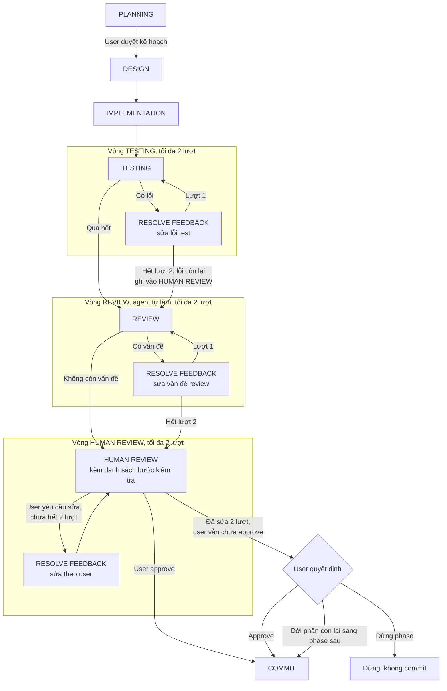

# QUY TRÌNH THỰC HIỆN PHASE

Quy trình áp dụng cho mọi phase của đồ án OGK. Sau IMPLEMENTATION có ba vòng lặp nối tiếp, mỗi vòng đi kèm RESOLVE FEEDBACK và có số lượt tối đa: TESTING (2 lượt), REVIEW do agent tự làm (2 lượt), HUMAN REVIEW (2 lượt).

## 1. Sơ đồ

## 2. Các bước

| Bước | Việc làm | Đầu ra | Điều kiện sang bước sau |
| :---- | :---- | :---- | :---- |
| PLANNING | Tạo branch của phase từ `main`; đọc file phase trong `plan/`, xác định phạm vi, task và câu hỏi còn mở | Kế hoạch chạy phase | User duyệt kế hoạch |
| DESIGN | Thiết kế API, lược đồ DB, module và giao thức cho phase | Thiết kế; cập nhật `docs/protocol.md` khi giao thức thay đổi; cập nhật `DB_SCHEMA.md` trong thư mục migrations của app khi lược đồ DB thay đổi | Thiết kế khớp kế hoạch đã duyệt |
| IMPLEMENTATION | Viết code theo task ID, đúng quy tắc module trong PLAN.md | Code và test của phase | Làm xong mọi task của phase |
| TESTING | Chạy test tự động và mọi mục kiểm tra nghiệm thu của phase; lint và format qua (mục 8). Từ P13, phase có ogk-agent build và cập nhật agent trên máy ảo Windows rồi chạy các mục nghiệm thu liên quan máy trẻ ở đó | Kết quả từng mục, kèm lỗi nếu có | Mọi mục qua, hoặc đã hết 2 lượt |
| RESOLVE FEEDBACK (sau TESTING) | Sửa lỗi của lượt TESTING vừa chạy | Code đã sửa | Lượt 1: chạy lại TESTING. Lượt 2: sang REVIEW, lỗi còn lại ghi vào HUMAN REVIEW |
| REVIEW | Agent tự review thay đổi, không cần user: đúng yêu cầu, bảo mật, quy tắc module, quy định comment và ngôn ngữ, quy định import, không có tệp bí mật, `DB_SCHEMA.md` khớp model và migration | Danh sách vấn đề | Danh sách rỗng thì sang HUMAN REVIEW |
| RESOLVE FEEDBACK (sau REVIEW) | Agent tự sửa từng vấn đề, chạy lại test tự động và mục nghiệm thu bị ảnh hưởng | Code đã sửa, kết quả test mới | Lượt 1: review lại. Lượt 2: sang HUMAN REVIEW |
| HUMAN REVIEW | Trình bày cho user theo mục 3 | Quyết định của user | User approve thì sang COMMIT; user yêu cầu sửa thì sang RESOLVE FEEDBACK |
| RESOLVE FEEDBACK (sau HUMAN REVIEW) | Sửa theo yêu cầu của user, chạy lại test liên quan, trình bày lại | Code đã sửa, kết quả test mới | Quay lại HUMAN REVIEW. Đã sửa 2 lượt mà user vẫn chưa approve thì user quyết định: approve, dời phần còn lại sang phase sau, hoặc dừng phase |
| COMMIT | Commit theo conventional commit trên branch của phase, merge branch vào `main` và push | Phase đã merge vào `origin/main` | Kết thúc phase |

### Cách tính lượt

- Một lượt gồm một lần chạy bước chính (TESTING, REVIEW hoặc HUMAN REVIEW) và một lần RESOLVE FEEDBACK sau nó. Bước chính không còn gì để sửa thì vòng kết thúc sớm.
- Mỗi lần RESOLVE FEEDBACK đều chạy lại test liên quan để xác nhận đã sửa; lần chạy lại này không tính là một lượt mới.
- Hết lượt thì không lặp thêm. Lỗi hay vấn đề còn lại không bị bỏ qua: agent ghi rõ trong HUMAN REVIEW để user quyết định.

## 3. Nội dung HUMAN REVIEW

Agent trình bày đủ các phần sau trong một tin nhắn:

- **Thay đổi:** tóm tắt theo app và theo task ID.
- **Kết quả test:** số test tự động qua của từng app, kết quả từng mục nghiệm thu, kèm bằng chứng như log hay sự kiện trên server.
- **Lỗi và vấn đề đã sửa:** liệt kê từ các vòng TESTING và REVIEW.
- **Còn mở:** lỗi chưa sửa xong khi hết lượt, giới hạn đã biết, chỗ lệch so với kế hoạch.
- **Danh sách kiểm tra cho user (bắt buộc):** danh sách gạch đầu dòng những gì user cần tự kiểm tra trước khi approve. Mỗi mục ghi rõ:
  - làm ở đâu: dashboard trên Mac kèm URL, hay máy ảo đăng nhập tài khoản nào;
  - các bước bấm hoặc lệnh cần chạy, theo thứ tự;
  - kết quả mong đợi để user biết qua hay không.

  User không phải hỏi lại cách kiểm tra. Mục nào agent đã tự kiểm tra hết thì không đưa vào danh sách này.
- **Commit dự kiến:** các commit message sẽ dùng.

## 4. Quy định branch và commit

- Mỗi phase làm trên một branch riêng tạo từ `main`, tên dạng `phase/p<số phase>`, ví dụ `phase/p5`.
- Không commit thẳng vào `main`.
- Tuyệt đối không commit, merge hoặc push khi user chưa approve ở bước HUMAN REVIEW.
- User approve cho một lần commit, merge hoặc push không áp dụng cho lần sau.
- Commit message theo conventional commit, ví dụ `feat(server): add parent login`.
- Không commit tệp bí mật: khóa, chứng chỉ, `.env`, DB.

## 5. Quy định lược đồ cơ sở dữ liệu

- Mỗi app có DB giữ hợp đồng lược đồ ở `DB_SCHEMA.md` trong thư mục migrations của app đó, gồm sơ đồ ER, định nghĩa từng bảng và ràng buộc toàn vẹn. Server: `ogk-server/migrations/DB_SCHEMA.md`; DB_SCHEMA.md của app khác theo cùng cấu trúc.
- Mọi thay đổi lược đồ DB đều cập nhật `DB_SCHEMA.md` của app đó trong cùng commit với model và migration: thêm, xóa, đổi tên bảng hoặc cột, đổi kiểu, nullable, mặc định, khóa, chỉ mục duy nhất, khóa ngoại, hành động khi xóa, hoặc luật kiểm tra dữ liệu trong code.
- Sơ đồ ER, bảng định nghĩa cột và ràng buộc toàn vẹn phải khớp model và migration. Ràng buộc do code kiểm tra thay vì DB thì ghi rõ trong phần Context.
- Mã ràng buộc `IC-nnn` không dùng lại sau khi xóa.
- Bảng nội bộ của công cụ migration, như `alembic_version`, không ghi trong tài liệu.

## 6. Quy định comment và ngôn ngữ

- Áp dụng cho mọi tệp trừ `.md`: mã nguồn, test, migration, script, cấu hình, `.gitignore`, `.env.example`, `docker-compose.yml`.
- Comment chỉ được đặt ở đầu tệp, trong một khối header. Không đặt comment giữa các dòng code: không comment cuối dòng, không docstring cho hàm hoặc class, không comment JSX `{/* */}`, không comment SQL trong chuỗi, không `# noqa`.
- Dòng bắt buộc ở đầu tệp như shebang `#!` hoặc `#Requires` giữ ở dòng 1; header đặt ngay sau.
- Comment viết bằng tiếng Anh.
- Chỉ comment khi code không tự nói được, tức là trả lời câu hỏi "tại sao" hoặc cảnh báo chỗ dễ bị sửa hỏng:
  - Giới hạn kỹ thuật không thấy được từ code, ví dụ SQLite không ALTER được AUTOINCREMENT.
  - Quyết định bảo mật hoặc riêng tư trông như code thừa, ví dụ băm giả để thời gian trả lời giống nhau.
  - Cam kết giữa các module mà chữ ký hàm không thể hiện, ví dụ `record()` không commit.
  - Định dạng dữ liệu hoặc thủ thuật dễ bị xóa nhầm, ví dụ import chỉ để đăng ký bảng.
  - Cách dùng của script và tệp cấu hình.
- Không comment khi:
  - Mô tả tệp làm gì trong khi tên tệp và tên hàm đã nói rõ.
  - Kể lại code, ví dụ liệt kê tên hàm.
  - Ghi kế hoạch hay lịch sử thay đổi; những thứ này thuộc `plan/` và git.
  - Lặp lại nội dung đã có trong `DB_SCHEMA.md` hoặc tài liệu khác.
  - Tóm tắt test khi tên hàm test đã nói đủ.
- Thông báo lỗi của hệ thống dùng tiếng Anh: exception, lỗi cấu hình, output của CLI và script, log, mô tả service.
- Chữ hiển thị cho người dùng trên dashboard và Tray UI dùng tiếng Việt. Lỗi hệ thống cần hiện lên giao diện thì mang mã lỗi; tầng giao diện đổi mã lỗi sang câu tiếng Việt.

## 7. Quy định import

- ogk-dashboard: mọi import tới tệp trong `src/` dùng alias `@/`, ví dụ `@/shared/components/index.ts`, kể cả import trong cùng feature và `@import` trong CSS. Không dùng đường dẫn tương đối `./` hoặc `../`.
- Alias `@/` trỏ tới `src/`, khai ở `paths` trong `tsconfig.app.json` và `resolve.alias` trong `vite.config.ts`; hai chỗ phải khớp nhau.
- ogk-server và ogk-agent: dùng import tuyệt đối từ gốc package (`app.`, `service.`, `tray.`, `tests.`). Không dùng import tương đối `from .` hoặc `from ..`, không sửa `sys.path`.

## 8. Lint và format

| App | Lint | Format | Cấu hình |
| :---- | :---- | :---- | :---- |
| ogk-server, ogk-agent | `ruff check` | `ruff format` | `ruff.toml` trong từng app; cài bằng `pip install -r requirements-dev.txt` |
| ogk-dashboard | `npm run lint` (oxlint); kiểm tra kiểu bằng `tsc -b` trong `npm run build` | `npm run format` (Prettier) | `.oxlintrc.json`, `.prettierrc.json`, `.prettierignore` |

- Hook Stop của Claude Code (`.claude/settings.json`, script `.claude/hooks/lint_format.py`) tự chạy khi agent xong một lượt: sửa lint và format các tệp đang thay đổi trong git. Lỗi lint không tự sửa được thì hook trả lại cho agent sửa một lần, sau đó chỉ báo cho user.
- Tệp `.md` không chạy formatter.
