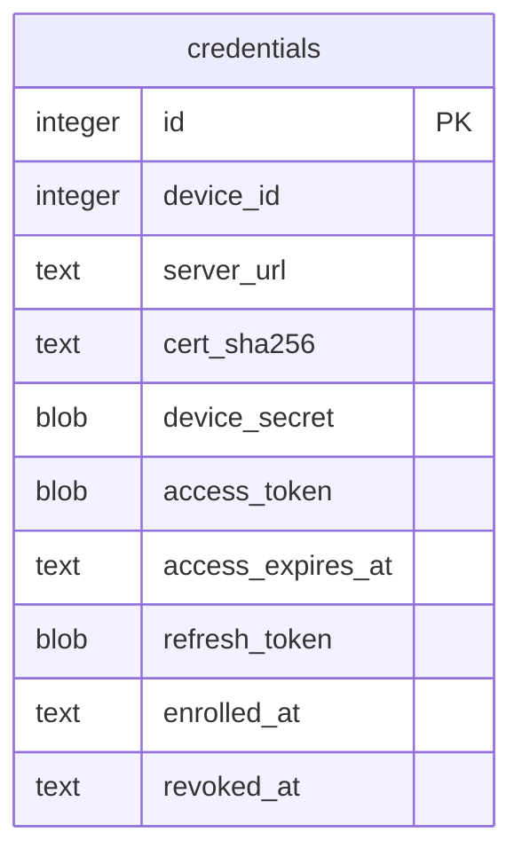

# Lược đồ cơ sở dữ liệu cục bộ của OGK Agent

DB SQLite `agent.db` nằm trong thư mục dữ liệu của agent: `%ProgramData%\OGK` trên Windows, `$OGK_DATA_DIR` (mặc định `.ogk-data`) trên Mac. Lược đồ do `service/core/local_db.py` tạo; phiên bản lưu ở `PRAGMA user_version`, mỗi phần tử của `SCHEMA` là một bước nâng phiên bản.

## Entity Relationship Diagram

## Table Definitions

### credentials

**Purpose:** Thông tin ghép đôi của máy này với OGK-Server. Có tối đa một dòng; ghép đôi lại thì ghi đè.

| Column | Description | Data type | Nullable? | Default |
|---|---|---|---|---|
| id | Luôn bằng 1 để bảng chỉ có một dòng. | Số nguyên | No | None |
| device_id | Định danh thiết bị do server cấp khi ghép đôi. | Số nguyên | No | None |
| server_url | URL server lúc ghép đôi; agent bỏ qua dòng này nếu `config.json` trỏ tới server khác. | Văn bản | No | None |
| cert_sha256 | SHA-256 dạng hex chữ thường của chứng chỉ server thấy được khi ghép đôi; mọi kết nối mang token phải trùng giá trị này. | Văn bản, đúng 64 ký tự hex | No | None |
| device_secret | Bản mã DPAPI của bí mật thiết bị, dùng khi làm mới token. | Bản mã DPAPI | No | None |
| access_token | Bản mã DPAPI của access token hiện hành. | Bản mã DPAPI | No | None |
| access_expires_at | Thời điểm access token hết hạn theo server. | Chuỗi ISO 8601 UTC | No | None |
| refresh_token | Bản mã DPAPI của refresh token hiện hành; đổi sau mỗi lần làm mới. | Bản mã DPAPI | No | None |
| enrolled_at | Thời điểm ghép đôi trên máy này. | Chuỗi ISO 8601 UTC | No | None |
| revoked_at | Thời điểm agent biết thiết bị bị gỡ hoặc refresh token bị từ chối; rỗng khi còn hiệu lực. | Chuỗi ISO 8601 UTC | Yes | None |

## Integrity Constraints

### IC-001: Chỉ một bộ thông tin ghép đôi

**Statement:** Bảng `credentials` có nhiều nhất một dòng.

**Formal Expression:**

$$
\forall c \in credentials:\ c.id = 1
$$

**Context:** DB kiểm tra bằng CHECK `id = 1` trên khóa chính. `save()` dùng `INSERT OR REPLACE` nên ghép đôi lại thay dòng cũ.

**Impacted Data Objects:**

- `credentials`
- Relevant attributes: `credentials.id`

### IC-002: Bí mật luôn được mã hóa DPAPI

**Statement:** Bí mật thiết bị, access token và refresh token chỉ được lưu dưới dạng bản mã DPAPI giải mã được trên máy này.

**Formal Expression:**

$$
\forall c \in credentials:\ U(c.device\_secret) \neq \bot \land U(c.access\_token) \neq \bot \land U(c.refresh\_token) \neq \bot
$$

**Context:** $U(x)$ là kết quả `CryptUnprotectData` với entropy của OGK; $\bot$ nghĩa là giải mã thất bại. DPAPI dùng phạm vi máy (`CRYPTPROTECT_LOCAL_MACHINE`) vì lệnh ghép đôi chạy bằng tài khoản quản trị còn service chạy bằng SYSTEM. Vì mọi tiến trình trên máy giải mã được, lớp bảo vệ chính là ACL: thư mục dữ liệu và `agent.db` chỉ cho SYSTEM và Administrators đọc ghi. Trên Mac, bản giả mã hóa bằng AES-GCM với khóa trong thư mục dữ liệu, chỉ để chạy test. Agent kiểm tra; DB không kiểm tra được.

**Impacted Data Objects:**

- `credentials`
- Relevant attributes: `credentials.device_secret`, `credentials.access_token`, `credentials.refresh_token`

### IC-003: Thiết bị đã thu hồi không gọi API

**Statement:** Khi `revoked_at` khác rỗng, agent không gửi request nào mang token thiết bị cho tới khi ghép đôi lại.

**Formal Expression:**

$$
\forall c \in credentials:\ c.revoked\_at \neq null \Rightarrow calls(c.device\_id) = \emptyset
$$

**Context:** $calls(d)$ là tập request mang token của thiết bị $d$ gửi sau thời điểm `revoked_at`. `core/device_session.py` kiểm tra trước mỗi request. Ghép đôi lại ghi dòng mới với `revoked_at` rỗng.

**Impacted Data Objects:**

- `credentials`
- Relevant attributes: `credentials.revoked_at`, `credentials.device_id`
