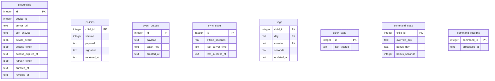

# Lược đồ cơ sở dữ liệu cục bộ của OGK Agent

DB SQLite `agent.db` nằm trong thư mục dữ liệu của agent: `%ProgramData%\OGK` trên Windows, `$OGK_DATA_DIR` (mặc định `.ogk-data`) trên Mac. Lược đồ do `service/core/local_db.py` tạo; phiên bản lưu ở `PRAGMA user_version`, mỗi phần tử của `SCHEMA` là một bước nâng phiên bản.

## Entity Relationship Diagram

## Table Definitions

### credentials

**Purpose:** Thông tin ghép đôi của máy này với OGK-Server. Có tối đa một dòng; ghép đôi lại thì ghi đè.

| Column | Description | Data type | Nullable? | Default |
|---|---|---|---|---|
| id | Luôn bằng 1 để bảng chỉ có một dòng. | Số nguyên | No | None |
| device_id | Định danh thiết bị do server cấp khi ghép đôi. | Số nguyên | No | None |
| server_url | URL server lúc ghép đôi; agent bỏ qua dòng này nếu `config.json` trỏ tới server khác. | Văn bản | No | None |
| cert_sha256 | SHA-256 dạng hex chữ thường của chứng chỉ server thấy được khi ghép đôi; mọi kết nối mang token phải trùng giá trị này. | Văn bản, đúng 64 ký tự hex | No | None |
| device_secret | Bản mã DPAPI của bí mật thiết bị, dùng khi làm mới token. | Bản mã DPAPI | No | None |
| access_token | Bản mã DPAPI của access token hiện hành. | Bản mã DPAPI | No | None |
| access_expires_at | Thời điểm access token hết hạn theo server. | Chuỗi ISO 8601 UTC | No | None |
| refresh_token | Bản mã DPAPI của refresh token hiện hành; đổi sau mỗi lần làm mới. | Bản mã DPAPI | No | None |
| enrolled_at | Thời điểm ghép đôi trên máy này. | Chuỗi ISO 8601 UTC | No | None |
| revoked_at | Thời điểm agent biết thiết bị bị gỡ hoặc refresh token bị từ chối; rỗng khi còn hiệu lực. | Chuỗi ISO 8601 UTC | Yes | None |

### policies

**Purpose:** Chính sách hợp lệ gần nhất của từng trẻ gắn với máy này, dùng khi mất kết nối server. Không có liên kết với `credentials`; `child_id` là id trẻ trên server. Dòng không được tin khi đọc: mỗi lần nạp, agent kiểm tra lại chữ ký.

| Column | Description | Data type | Nullable? | Default |
|---|---|---|---|---|
| child_id | Trẻ được áp chính sách; bằng `child_id` trong tài liệu đã ký. | Số nguyên | No | None |
| version | `policy_version`; bằng giá trị trong tài liệu đã ký. | Số nguyên từ 1 | No | None |
| payload | Tài liệu chính sách ở dạng JSON chuẩn hóa, đúng bytes mà server đã ký. | Văn bản UTF-8 | No | None |
| signature | Chữ ký Ed25519 của `payload`, base64url không có `=`. | Văn bản | No | None |
| received_at | Thời điểm agent nhận và lưu lô chính sách này. | Văn bản ISO 8601 UTC | No | None |

### event_outbox

**Purpose:** Sự kiện chờ gửi lên server. Sự kiện được ghi vào đây trước mọi lần gửi nên mất mạng hay khởi động lại không làm mất sự kiện; dòng bị xóa khi server xác nhận lô.

| Column | Description | Data type | Nullable? | Default |
|---|---|---|---|---|
| id | Thứ tự ghi; lô lấy các dòng cũ nhất trước. | Số nguyên, tự tăng | No | Tự sinh |
| payload | Sự kiện 7 trường dạng JSON, đã kiểm tra lược đồ trước khi ghi. | Văn bản UTF-8 | No | None |
| batch_key | Idempotency key của lô chứa dòng này; gán và lưu trước lần gửi đầu, giữ nguyên qua mọi lần gửi lại. Rỗng khi dòng chưa vào lô nào. | Văn bản UUID4 | Yes | None |
| created_at | Thời điểm agent ghi sự kiện vào hàng đợi. | Văn bản ISO 8601 UTC | No | None |

### sync_state

**Purpose:** Trạng thái kết nối để đo thời gian mất kết nối qua các lần khởi động lại. Có tối đa một dòng.

| Column | Description | Data type | Nullable? | Default |
|---|---|---|---|---|
| id | Luôn bằng 1 để bảng chỉ có một dòng. | Số nguyên | No | None |
| offline_seconds | Số giây mất kết nối cộng dồn bằng đồng hồ đơn điệu từ heartbeat thành công gần nhất. | Số thực không âm | No | None |
| last_server_time | `server_time` của heartbeat thành công gần nhất. | Văn bản ISO 8601 UTC | Yes | None |
| last_success_at | Giờ hệ thống lúc heartbeat thành công gần nhất. | Văn bản ISO 8601 UTC | Yes | None |

### usage

**Purpose:** Số giây đã dùng máy theo trẻ, ngày và bộ đếm, để khởi động lại service không mất thời gian đã dùng. Ngày cũ được giữ lại cho báo cáo sau này.

| Column | Description | Data type | Nullable? | Default |
|---|---|---|---|---|
| child_id | Trẻ được đếm, lấy từ chính sách đã ký có SID của phiên. Không có khóa ngoại vì chính sách của trẻ có thể bị xóa khi server bỏ gán. | Số nguyên | No | None |
| day | Ngày theo giờ địa phương của đồng hồ tin cậy, không theo giờ hệ thống. | Văn bản `YYYY-MM-DD` | No | None |
| counter | Tên bộ đếm: `child` là tổng thời gian của trẻ; các phase sau thêm bộ đếm khác, ví dụ theo nhóm ứng dụng. | Văn bản | No | None |
| seconds | Số giây đã đếm trong ngày. | Số thực không âm | No | None |
| updated_at | Giờ tin cậy lúc ghi gần nhất. | Văn bản ISO 8601 UTC | No | None |

### clock_state

**Purpose:** Giờ tin cậy gần nhất đã lưu, để lùi giờ hệ thống rồi khởi động lại không làm thời gian lùi theo. Có tối đa một dòng.

| Column | Description | Data type | Nullable? | Default |
|---|---|---|---|---|
| id | Luôn bằng 1 để bảng chỉ có một dòng. | Số nguyên | No | None |
| last_trusted | Giờ tin cậy lúc lưu gần nhất; lúc khởi động, đồng hồ tin cậy bắt đầu từ giá trị lớn hơn giữa cột này và giờ hệ thống. | Văn bản ISO 8601 UTC | No | None |

### command_state

**Purpose:** Trạng thái cộng thời gian và override mở khóa của lệnh phụ huynh, để khởi động lại service không làm mất hiệu lực hoặc cộng lặp.

| Column | Description | Data type | Nullable? | Default |
|---|---|---|---|---|
| child_id | ID trẻ trên server, khóa chính; không có khóa ngoại vì chính sách cục bộ có thể bị xóa khi gỡ gán. | Số nguyên | No | None |
| override_day | Ngày địa phương mà lệnh mở khóa còn hiệu lực. | Văn bản `YYYY-MM-DD` | Yes | None |
| bonus_day | Ngày địa phương mà số dư cộng thêm còn hiệu lực. | Văn bản `YYYY-MM-DD` | Yes | None |
| bonus_seconds | Số giây cộng thêm chưa dùng trong ngày. | Số nguyên không âm | No | 0 |

### command_receipts

**Purpose:** Ghi nhận ID lệnh đã thực hiện để heartbeat và WebSocket, kể cả sau khi service khởi động lại, không thực hiện lệnh hai lần.

| Column | Description | Data type | Nullable? | Default |
|---|---|---|---|---|
| command_id | ID lệnh server; khóa chính. | Số nguyên | No | None |
| processed_at | Thời điểm agent thực hiện lệnh. | Văn bản ISO 8601 UTC | No | None |

## Integrity Constraints

### IC-001: Chỉ một bộ thông tin ghép đôi

**Statement:** Bảng `credentials` có nhiều nhất một dòng.

**Formal Expression:**

$$
\forall c \in credentials:\ c.id = 1
$$

**Context:** DB kiểm tra bằng CHECK `id = 1` trên khóa chính. `save()` dùng `INSERT OR REPLACE` nên ghép đôi lại thay dòng cũ.

**Impacted Data Objects:**

- `credentials`
- Relevant attributes: `credentials.id`

### IC-002: Bí mật luôn được mã hóa DPAPI

**Statement:** Bí mật thiết bị, access token và refresh token chỉ được lưu dưới dạng bản mã DPAPI giải mã được trên máy này.

**Formal Expression:**

$$
\forall c \in credentials:\ U(c.device\_secret) \neq \bot \land U(c.access\_token) \neq \bot \land U(c.refresh\_token) \neq \bot
$$

**Context:** $U(x)$ là kết quả `CryptUnprotectData` với entropy của OGK; $\bot$ nghĩa là giải mã thất bại. DPAPI dùng phạm vi máy (`CRYPTPROTECT_LOCAL_MACHINE`) vì lệnh ghép đôi chạy bằng tài khoản quản trị còn service chạy bằng SYSTEM. Vì mọi tiến trình trên máy giải mã được, lớp bảo vệ chính là ACL: thư mục dữ liệu và `agent.db` chỉ cho SYSTEM và Administrators đọc ghi. Trên Mac, bản giả mã hóa bằng AES-GCM với khóa trong thư mục dữ liệu, chỉ để chạy test. Agent kiểm tra; DB không kiểm tra được.

**Impacted Data Objects:**

- `credentials`
- Relevant attributes: `credentials.device_secret`, `credentials.access_token`, `credentials.refresh_token`

### IC-003: Thiết bị đã thu hồi không gọi API

**Statement:** Khi `revoked_at` khác rỗng, agent không gửi request nào mang token thiết bị cho tới khi ghép đôi lại.

**Formal Expression:**

$$
\forall c \in credentials:\ c.revoked\_at \neq null \Rightarrow calls(c.device\_id) = \emptyset
$$

**Context:** $calls(d)$ là tập request mang token của thiết bị $d$ gửi sau thời điểm `revoked_at`. `core/device_session.py` kiểm tra trước mỗi request. Ghép đôi lại ghi dòng mới với `revoked_at` rỗng.

**Impacted Data Objects:**

- `credentials`
- Relevant attributes: `credentials.revoked_at`, `credentials.device_id`

### IC-004: Chỉ áp chính sách có chữ ký đúng

**Statement:** Một dòng `policies` chỉ được dùng khi chữ ký Ed25519 của `payload` đúng với khóa công khai của server, và `child_id`, `version` khớp tài liệu đã ký. Thiếu khóa công khai thì không dòng nào được dùng.

**Formal Expression:**

$$
\forall p \in policies:\ used(p) \Rightarrow Verify(pk, p.payload, p.signature) \land doc(p).child\_id = p.child\_id \land doc(p).policy\_version = p.version
$$

**Context:** $pk$ là khóa trong tệp `policy_public_key` của `config.json`; $doc(p)$ là JSON trong `payload`. `core/policy_store.py` kiểm tra khi nhận từ server và mỗi lần nạp từ DB; dòng sai bị bỏ qua và ghi log. DB không kiểm tra.

**Impacted Data Objects:**

- `policies`
- Relevant attributes: `policies.payload`, `policies.signature`, `policies.child_id`, `policies.version`

### IC-005: Phiên bản chính sách không lùi

**Statement:** Agent không thay chính sách của một trẻ bằng bản có `policy_version` thấp hơn bản đang giữ. Lô chính sách được thay cả bộ trong một giao dịch: trẻ không còn trong lô thì bị xóa.

**Formal Expression:**

$$
\forall p \in policies,\ p' \in policies':\ p.child\_id = p'.child\_id \Rightarrow p'.version \geq p.version
$$

**Context:** $policies$ là tập trước khi lưu, $policies'$ là tập sau khi lưu. `PolicyStore.save` kiểm tra trước khi ghi; một vi phạm làm cả lô bị từ chối. DB không kiểm tra.

**Impacted Data Objects:**

- `policies`
- Relevant attributes: `policies.child_id`, `policies.version`

### IC-006: Sự kiện chờ gửi đúng lược đồ

**Statement:** Mỗi `payload` trong `event_outbox` là một sự kiện đúng 7 trường với `type` thuộc 9 loại quy định.

**Formal Expression:**

$$
\forall e \in event\_outbox:\ keys(e.payload) = \{ts, device\_id, child\_id, type, subject, duration\_sec, policy\_id\} \land e.payload.type \in Types
$$

**Context:** $Types$ là 9 loại trong `service/core/events.py`. `EventQueue.enqueue` kiểm tra bằng `validate_event` trước khi ghi; sự kiện sai làm cả lần ghi bị từ chối. DB không kiểm tra.

**Impacted Data Objects:**

- `event_outbox`
- Relevant attributes: `event_outbox.payload`

### IC-007: Khóa lô cố định cho tới khi server xác nhận

**Statement:** Một dòng đã có `batch_key` thì giữ nguyên khóa đó cho tới khi bị xóa. Các dòng cùng khóa luôn được gửi cùng nhau, và tại mỗi thời điểm chỉ có tối đa một khóa đang chờ.

**Formal Expression:**

$$
\forall e \in event\_outbox,\ e' \in event\_outbox':\ e.id = e'.id \land e.batch\_key \neq NULL \Rightarrow e'.batch\_key = e.batch\_key \quad \land \quad |\{e.batch\_key \mid e \in event\_outbox,\ e.batch\_key \neq NULL\}| \leq 1
$$

**Context:** $event\_outbox'$ là trạng thái sau một thao tác bất kỳ. `LocalDb.next_event_batch` trả lô đang chờ nếu có, chỉ gán khóa mới khi không còn lô chờ, và lưu khóa trong cùng giao dịch trước khi gửi. Nhờ đó gửi lại sau lỗi mạng hay khởi động lại luôn dùng cùng khóa và server không đếm trùng. DB không kiểm tra.

**Impacted Data Objects:**

- `event_outbox`
- Relevant attributes: `event_outbox.id`, `event_outbox.batch_key`

### IC-008: Chỉ một trạng thái đồng bộ

**Statement:** `sync_state` có tối đa một dòng với `id = 1`, và `offline_seconds` không âm.

**Formal Expression:**

$$
\forall s \in sync\_state:\ s.id = 1 \land s.offline\_seconds \geq 0
$$

**Context:** DB kiểm tra bằng `CHECK (id = 1)` và `CHECK (offline_seconds >= 0)`. `SyncClock` chỉ cộng các khoảng không âm của đồng hồ đơn điệu và đặt lại về 0 khi heartbeat thành công.

**Impacted Data Objects:**

- `sync_state`
- Relevant attributes: `sync_state.id`, `sync_state.offline_seconds`

### IC-009: Thời gian đã dùng không âm và duy nhất theo ngày

**Statement:** Mỗi bộ (trẻ, ngày, bộ đếm) có tối đa một dòng và `seconds` không âm. Thời gian chỉ tăng trong ngày.

**Formal Expression:**

$$
\forall u_1, u_2 \in usage:\ (u_1.child\_id, u_1.day, u_1.counter) = (u_2.child\_id, u_2.day, u_2.counter) \Rightarrow u_1 = u_2 \quad \land \quad \forall u \in usage:\ u.seconds \geq 0 \land u'.seconds \geq u.seconds
$$

**Context:** DB kiểm tra bằng khóa chính ghép và `CHECK (seconds >= 0)`. $u'$ là dòng sau khi ghi; việc chỉ tăng do `CounterSet` bảo đảm vì nó chỉ cộng các khoảng không âm của đồng hồ đơn điệu, mỗi tick tối đa 2 giây.

**Impacted Data Objects:**

- `usage`
- Relevant attributes: `usage.child_id`, `usage.day`, `usage.counter`, `usage.seconds`

### IC-010: Chỉ một mốc giờ tin cậy

**Statement:** `clock_state` có tối đa một dòng với `id = 1`.

**Formal Expression:**

$$
\forall c \in clock\_state:\ c.id = 1
$$

**Context:** DB kiểm tra bằng `CHECK (id = 1)`; `TrustedClock.save` ghi bằng `INSERT OR REPLACE`.

**Impacted Data Objects:**

- `clock_state`
- Relevant attributes: `clock_state.id`, `clock_state.last_trusted`

### IC-011: Trạng thái thời gian lệnh không âm và duy nhất theo trẻ

**Statement:** Mỗi trẻ có tối đa một trạng thái lệnh và thời gian cộng thêm không âm.

**Context:** DB kiểm tra bằng khóa chính `command_state.child_id` và `CHECK (bonus_seconds >= 0)`. Lệnh cộng thời gian tăng số dư; tick chỉ giảm theo thời gian hoạt động. Trạng thái rỗng (không override, bonus bằng 0) không giữ dòng: lần lưu đó xóa dòng của trẻ.

**Impacted Data Objects:** `command_state`

### IC-012: Mỗi lệnh có tối đa một biên nhận

**Statement:** Mỗi `command_id` được agent ghi nhận tối đa một lần.

**Context:** DB kiểm tra bằng khóa chính `command_receipts.command_id`; CommandState tra cứu trước khi gọi handler và ghi biên nhận sau khi handler hoàn tất.

**Impacted Data Objects:** `command_receipts`

### IC-013: Dữ liệu cục bộ chỉ giữ 90 ngày

**Statement:** Không giữ quá 90 ngày: `usage` theo `day` (ngày địa phương), `event_outbox` theo `created_at`, `command_receipts` theo `processed_at`.

**Context:** DB không kiểm tra. Module retention xóa khi service khởi động và sau đó mỗi 24 giờ, lấy mốc từ giờ tin cậy; giữa hai lần chạy, dữ liệu có thể quá hạn tối đa một ngày.

**Impacted Data Objects:** `usage.day`, `event_outbox.created_at`, `command_receipts.processed_at`

### IC-014: Lệnh xóa bộ đệm xóa hết dữ liệu cục bộ của trẻ trước khi xác nhận

**Statement:** Sau khi xử lý xong lệnh `purge_child` cho một `child_id`, `usage`, `command_state` và `event_outbox` (theo `child_id` trong `payload`) không còn dòng nào của trẻ đó. `policies` được giữ vì chính sách hiện hành vẫn còn trên server.

**Context:** Code bảo đảm, DB không kiểm tra. Module retention phát `CHILD_PURGED` để screen time bỏ bộ đếm trong bộ nhớ trước, rồi xóa trong một giao dịch. Biên nhận lệnh và xác nhận với server chỉ ghi sau khi xóa thành công.

**Impacted Data Objects:** `usage`, `command_state`, `event_outbox`, `command_receipts`
