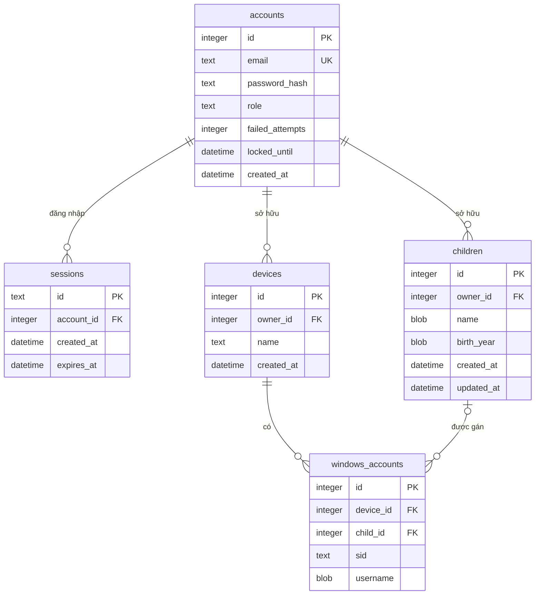

# Lược đồ cơ sở dữ liệu OGK-Server

## Entity Relationship Diagram

## Table Definitions

### accounts

**Purpose:** Một tài khoản đăng nhập dashboard, vai trò phụ huynh hoặc admin.

| Column | Description | Data type | Nullable? | Default |
|---|---|---|---|---|
| id | Định danh tài khoản. | Số nguyên, tự tăng | No | Tự sinh |
| email | Email đăng nhập, đã bỏ khoảng trắng hai đầu và chuyển chữ thường. | Văn bản, tối đa 254 ký tự | No | None |
| password_hash | Hàm băm Argon2id của mật khẩu; không lưu mật khẩu gốc. | Văn bản, tối đa 255 ký tự | No | None |
| role | Vai trò của tài khoản: `parent` hoặc `admin`. | Văn bản, tối đa 16 ký tự | No | None |
| failed_attempts | Số lần sai mật khẩu liên tiếp kể từ lần đăng nhập đúng hoặc lần khóa gần nhất. | Số nguyên, 0 đến 4 | No | 0 |
| locked_until | Thời điểm hết khóa sau 5 lần sai; rỗng khi chưa từng khóa hoặc đã mở khóa. | Thời điểm UTC | Yes | None |
| created_at | Thời điểm tạo tài khoản. | Thời điểm UTC | No | None |

### sessions

**Purpose:** Một phiên đăng nhập dashboard còn hiệu lực hoặc chưa được dọn.

| Column | Description | Data type | Nullable? | Default |
|---|---|---|---|---|
| id | SHA-256 dạng hex của token phiên; server không lưu token gốc. | Văn bản, đúng 64 ký tự hex | No | None |
| account_id | Tài khoản của phiên, tham chiếu `accounts.id`. | Số nguyên | No | None |
| created_at | Thời điểm đăng nhập. | Thời điểm UTC | No | None |
| expires_at | Thời điểm phiên hết hạn tuyệt đối, bằng `created_at` cộng 12 giờ. | Thời điểm UTC | No | None |

### children

**Purpose:** Một trẻ do một phụ huynh quản lý. Tên và năm sinh được mã hóa AES-GCM khi lưu.

| Column | Description | Data type | Nullable? | Default |
|---|---|---|---|---|
| id | Định danh trẻ. | Số nguyên, tự tăng | No | Tự sinh |
| owner_id | Phụ huynh sở hữu trẻ, tham chiếu `accounts.id`. | Số nguyên | No | None |
| name | Bản mã AES-GCM của tên trẻ; AAD là `children.name`. | Bản mã của văn bản 1 đến 64 ký tự | No | None |
| birth_year | Bản mã AES-GCM của năm sinh; AAD là `children.birth_year`. | Bản mã của số nguyên từ 2000 đến năm hiện tại | No | None |
| created_at | Thời điểm thêm trẻ. | Thời điểm UTC | No | None |
| updated_at | Thời điểm sửa thông tin trẻ gần nhất. | Thời điểm UTC | No | Bằng `created_at` khi tạo |

### devices

**Purpose:** Một máy tính Windows của gia đình đã ghép đôi với server.

| Column | Description | Data type | Nullable? | Default |
|---|---|---|---|---|
| id | Định danh thiết bị. | Số nguyên, tự tăng | No | Tự sinh |
| owner_id | Phụ huynh sở hữu thiết bị, tham chiếu `accounts.id`. | Số nguyên | No | None |
| name | Tên hiển thị của thiết bị trên dashboard. | Văn bản, tối đa 64 ký tự | No | None |
| created_at | Thời điểm ghép đôi thiết bị. | Thời điểm UTC | No | None |

### windows_accounts

**Purpose:** Một tài khoản Windows trên một thiết bị, gán cho tối đa một trẻ. Đây là cầu nối n trẻ : m thiết bị.

| Column | Description | Data type | Nullable? | Default |
|---|---|---|---|---|
| id | Định danh tài khoản Windows. | Số nguyên, tự tăng | No | Tự sinh |
| device_id | Thiết bị chứa tài khoản, tham chiếu `devices.id`. | Số nguyên | No | None |
| child_id | Trẻ dùng tài khoản này, tham chiếu `children.id`; rỗng khi chưa gán. | Số nguyên | Yes | None |
| sid | Security Identifier của tài khoản Windows trên thiết bị. | Văn bản, tối đa 184 ký tự | No | None |
| username | Bản mã AES-GCM của tên đăng nhập Windows; AAD là `windows_accounts.username`. | Bản mã của văn bản | No | None |

## Integrity Constraints

### IC-001: Email tài khoản là duy nhất

**Statement:** Hai tài khoản khác nhau không được có cùng email.

**Formal Expression:**

$$
\forall a_1, a_2 \in accounts:\ a_1.email = a_2.email \Rightarrow a_1 = a_2
$$

**Context:** Áp dụng cho mọi tài khoản, cả `parent` và `admin`. Email được chuẩn hóa trước khi so sánh nên khác hoa thường vẫn tính là trùng. DB kiểm tra bằng ràng buộc UNIQUE.

**Impacted Data Objects:**

- `accounts`
- Relevant attributes: `accounts.email`

### IC-002: Vai trò hợp lệ

**Statement:** Vai trò của tài khoản chỉ được là `parent` hoặc `admin`.

**Formal Expression:**

$$
\forall a \in accounts:\ a.role \in \{parent, admin\}
$$

**Context:** Áp dụng cho mọi tài khoản. Vai trò `child-view` không phải tài khoản mà là quyền của token thiết bị nên không nằm trong bảng này. DB kiểm tra bằng CHECK `ck_accounts_role`.

**Impacted Data Objects:**

- `accounts`
- Relevant attributes: `accounts.role`

### IC-003: Bộ đếm sai mật khẩu trong giới hạn

**Statement:** Số lần sai mật khẩu liên tiếp phải từ 0 đến 4.

**Formal Expression:**

$$
\forall a \in accounts:\ 0 \le a.failed\_attempts \le 4
$$

**Context:** Lần sai thứ 5 khóa tài khoản và đưa bộ đếm về 0, nên giá trị 5 không bao giờ được lưu lại. Server kiểm tra trong `auth/service.py`; DB không có CHECK.

**Impacted Data Objects:**

- `accounts`
- Relevant attributes: `accounts.failed_attempts`

### IC-004: Phiên thuộc tài khoản tồn tại

**Statement:** Mỗi phiên phải thuộc một tài khoản tồn tại; xóa tài khoản thì xóa mọi phiên của tài khoản đó.

**Formal Expression:**

$$
\forall s \in sessions\ \exists a \in accounts:\ s.account\_id = a.id
$$

**Context:** Áp dụng cho mọi phiên. DB kiểm tra bằng khóa ngoại với `ON DELETE CASCADE`; SQLite bật `PRAGMA foreign_keys=ON` trên mọi kết nối.

**Impacted Data Objects:**

- `sessions`
- `accounts`
- Relevant attributes: `sessions.account_id`, `accounts.id`

### IC-005: Phiên hết hạn sau 12 giờ

**Statement:** Thời điểm hết hạn của phiên phải bằng thời điểm đăng nhập cộng 12 giờ.

**Formal Expression:**

$$
\forall s \in sessions:\ s.expires\_at = s.created\_at + 12h
$$

**Context:** $12h$ là khoảng thời gian 12 giờ. Phiên có `expires_at` đã qua bị coi như không tồn tại và được xóa khi đọc tới hoặc khi tạo phiên mới. Server kiểm tra; DB không có CHECK.

**Impacted Data Objects:**

- `sessions`
- Relevant attributes: `sessions.created_at`, `sessions.expires_at`

### IC-006: Trẻ thuộc một phụ huynh

**Statement:** Mỗi trẻ phải thuộc một tài khoản tồn tại có vai trò `parent`; xóa tài khoản thì xóa mọi trẻ của tài khoản đó.

**Formal Expression:**

$$
\forall c \in children\ \exists a \in accounts:\ c.owner\_id = a.id \land a.role = parent
$$

**Context:** DB kiểm tra phần tồn tại bằng khóa ngoại với `ON DELETE CASCADE`. Phần vai trò do server kiểm tra: chỉ phiên `parent` gọi được API tạo trẻ.

**Impacted Data Objects:**

- `children`
- `accounts`
- Relevant attributes: `children.owner_id`, `accounts.id`, `accounts.role`

### IC-007: Tên trẻ hợp lệ

**Statement:** Tên trẻ sau khi giải mã phải dài từ 1 đến 64 ký tự và không có khoảng trắng ở hai đầu.

**Formal Expression:**

$$
\forall c \in children:\ 1 \le |D(c.name)| \le 64 \land D(c.name) = trim(D(c.name))
$$

**Context:** $D(x)$ là giá trị giải mã AES-GCM của bản mã $x$ bằng khóa `OGK_DATA_KEY` và AAD của cột; $|s|$ là số ký tự của chuỗi $s$; $trim(s)$ là $s$ bỏ khoảng trắng hai đầu. Server kiểm tra; DB chỉ thấy bản mã nên không kiểm tra được.

**Impacted Data Objects:**

- `children`
- Relevant attributes: `children.name`

### IC-008: Năm sinh hợp lệ

**Statement:** Năm sinh của trẻ sau khi giải mã phải từ 2000 đến năm hiện tại.

**Formal Expression:**

$$
\forall c \in children:\ 2000 \le D(c.birth\_year) \le Y
$$

**Context:** $D(x)$ như IC-007; $Y$ là năm hiện tại theo UTC tại thời điểm ghi. Server kiểm tra khi tạo và sửa; DB không kiểm tra được.

**Impacted Data Objects:**

- `children`
- Relevant attributes: `children.birth_year`

### IC-009: Trường nhạy cảm luôn được mã hóa

**Statement:** Tên trẻ, năm sinh và tên đăng nhập Windows phải được lưu dưới dạng bản mã AES-GCM giải mã được bằng khóa hiện hành và đúng AAD của cột.

**Formal Expression:**

$$
\forall c \in children:\ D_{children.name}(c.name) \neq \bot \land D_{children.birth\_year}(c.birth\_year) \neq \bot \\
\forall w \in windows\_accounts:\ D_{windows\_accounts.username}(w.username) \neq \bot
$$

**Context:** $D_{t}(x)$ giải mã $x$ bằng khóa `OGK_DATA_KEY` với AAD $t$; $\bot$ nghĩa là giải mã thất bại. Bản mã có dạng: 1 byte phiên bản `0x01`, 12 byte nonce, bản mã kèm tag 16 byte. Kiểu `EncryptedString` và `EncryptedInt` trong `app/core/crypto.py` mã hóa mọi lần ghi.

**Impacted Data Objects:**

- `children`
- `windows_accounts`
- Relevant attributes: `children.name`, `children.birth_year`, `windows_accounts.username`

### IC-010: Thiết bị thuộc một phụ huynh

**Statement:** Mỗi thiết bị phải thuộc một tài khoản tồn tại; xóa tài khoản thì xóa mọi thiết bị của tài khoản đó.

**Formal Expression:**

$$
\forall d \in devices\ \exists a \in accounts:\ d.owner\_id = a.id
$$

**Context:** DB kiểm tra bằng khóa ngoại với `ON DELETE CASCADE`.

**Impacted Data Objects:**

- `devices`
- `accounts`
- Relevant attributes: `devices.owner_id`, `accounts.id`

### IC-011: Tài khoản Windows thuộc thiết bị tồn tại

**Statement:** Mỗi tài khoản Windows phải thuộc một thiết bị tồn tại; xóa thiết bị thì xóa mọi tài khoản Windows của thiết bị đó.

**Formal Expression:**

$$
\forall w \in windows\_accounts\ \exists d \in devices:\ w.device\_id = d.id
$$

**Context:** DB kiểm tra bằng khóa ngoại với `ON DELETE CASCADE`.

**Impacted Data Objects:**

- `windows_accounts`
- `devices`
- Relevant attributes: `windows_accounts.device_id`, `devices.id`

### IC-012: SID duy nhất trên mỗi thiết bị

**Statement:** Trên cùng một thiết bị, hai tài khoản Windows khác nhau không được có cùng SID.

**Formal Expression:**

$$
\forall w_1, w_2 \in windows\_accounts:\ w_1.device\_id = w_2.device\_id \land w_1.sid = w_2.sid \Rightarrow w_1 = w_2
$$

**Context:** Cùng một SID trên hai thiết bị khác nhau được phép. DB kiểm tra bằng ràng buộc UNIQUE `uq_windows_accounts_device_sid`.

**Impacted Data Objects:**

- `windows_accounts`
- Relevant attributes: `windows_accounts.device_id`, `windows_accounts.sid`

### IC-013: Trẻ được gán tồn tại hoặc bỏ trống

**Statement:** Tài khoản Windows chỉ được gán cho một trẻ tồn tại; xóa trẻ thì các tài khoản Windows của trẻ đó về trạng thái chưa gán.

**Formal Expression:**

$$
\forall w \in windows\_accounts:\ w.child\_id = null \lor \exists c \in children:\ w.child\_id = c.id
$$

**Context:** $null$ nghĩa là chưa gán cho trẻ nào. DB kiểm tra bằng khóa ngoại với `ON DELETE SET NULL`; thiết bị vẫn giữ nguyên khi xóa trẻ.

**Impacted Data Objects:**

- `windows_accounts`
- `children`
- Relevant attributes: `windows_accounts.child_id`, `children.id`

### IC-014: Trẻ và thiết bị cùng phụ huynh

**Statement:** Tài khoản Windows chỉ được gán cho trẻ cùng phụ huynh với thiết bị chứa tài khoản đó.

**Formal Expression:**

$$
\forall w \in windows\_accounts\ \forall d \in devices\ \forall c \in children:\ w.device\_id = d.id \land w.child\_id = c.id \Rightarrow c.owner\_id = d.owner\_id
$$

**Context:** Áp dụng cho tài khoản Windows đã gán; tài khoản chưa gán không bị ràng buộc. DB không kiểm tra được qua hai bảng. Hiện chưa có API ghi bảng này; API gán ở P8 phải kiểm tra trước khi ghi.

**Impacted Data Objects:**

- `windows_accounts`
- `devices`
- `children`
- Relevant attributes: `windows_accounts.device_id`, `windows_accounts.child_id`, `devices.id`, `devices.owner_id`, `children.id`, `children.owner_id`
