# Lược đồ cơ sở dữ liệu OGK-Server

## Entity Relationship Diagram

```mermaid
erDiagram
    accounts ||--o{ sessions : "đăng nhập"
    accounts ||--o{ children : "sở hữu"
    accounts ||--o{ devices : "sở hữu"
    devices ||--o{ windows_accounts : "có"
    children |o--o{ windows_accounts : "được gán"
    accounts ||--o{ audit_logs : "thực hiện"
    accounts ||--o{ pairing_codes : "tạo"
    devices |o--o| pairing_codes : "ghép bằng"
    devices ||--o{ device_tokens : "có"
    accounts ||--o{ consent_records : "đồng ý"
    devices ||--o{ consent_records : "được đồng ý"
    children ||--o| policies : "có"
    accounts |o--o{ policies : "sửa gần nhất"
    children ||--o{ policy_versions : "có lịch sử"
    accounts |o--o{ policy_versions : "đặt"
    devices ||--o{ events : "ghi"
    children ||--o{ events : "thuộc"
    devices ||--o{ event_batches : "gửi"
    devices ||--o{ device_alerts : "báo"
    devices ||--o{ parent_commands : "nhận"
    children ||--o{ parent_commands : "điều khiển"
    accounts ||--o{ parent_commands : "gửi"
    devices ||--o{ child_requests : "gửi"
    children ||--o{ child_requests : "tạo"
    accounts |o--o{ child_requests : "duyệt"
    devices ||--o{ daily_usage : "báo"
    children ||--o{ daily_usage : "dùng"
    devices ||--o{ child_view_codes : "đăng ký"
    children ||--o{ child_view_codes : "được xem"
    devices ||--o{ child_view_sessions : "mở"
    children ||--o{ child_view_sessions : "được xem"
    accounts {
        integer id PK
        text email UK
        text password_hash
        text role
        integer failed_attempts
        datetime locked_until
        datetime created_at
    }
    sessions {
        text id PK
        integer account_id FK
        datetime created_at
        datetime expires_at
    }
    children {
        integer id PK
        integer owner_id FK
        blob name
        blob birth_year
        datetime created_at
        datetime updated_at
    }
    devices {
        integer id PK
        integer owner_id FK
        text name
        datetime created_at
        text fingerprint_hash
        text secret_hash
        datetime revoked_at
        datetime last_seen_at
    }
    windows_accounts {
        integer id PK
        integer device_id FK
        integer child_id FK
        text sid
        blob username
    }
    audit_logs {
        integer id PK
        integer actor_id FK
        datetime at
        text ip
        text action
        text target_type
        integer target_id
        blob old_value
        blob new_value
    }
    pairing_codes {
        integer id PK
        integer owner_id FK
        text code_hash UK
        datetime created_at
        datetime expires_at
        datetime used_at
        integer device_id FK
        text consent_ip
    }
    device_tokens {
        integer id PK
        integer device_id FK
        text kind
        text token_hash UK
        datetime created_at
        datetime expires_at
        datetime revoked_at
    }
    consent_records {
        integer id PK
        integer account_id FK
        integer device_id FK
        datetime consented_at
        text ip
        text consent_version
    }
    policies {
        integer child_id PK, FK
        integer version
        integer weekday_quota_minutes
        integer weekend_quota_minutes
        text weekly_schedule
        text app_rules
        text web_allowlist
        text web_blocklist
        text blocked_categories
        integer updated_by FK
        datetime updated_at
    }
    policy_versions {
        integer id PK
        integer child_id FK
        integer version
        integer weekday_quota_minutes
        integer weekend_quota_minutes
        text weekly_schedule
        text app_rules
        text web_allowlist
        text web_blocklist
        text blocked_categories
        integer set_by FK
        datetime created_at
    }
    events {
        integer id PK
        datetime ts
        integer device_id FK
        integer child_id FK
        text type
        text subject
        integer duration_sec
        integer policy_id
    }
    event_batches {
        integer id PK
        integer device_id FK
        text idempotency_key
        datetime received_at
        integer event_count
    }
    device_alerts {
        integer id PK
        integer device_id FK
        text type
        text detail
        datetime first_seen_at
        datetime last_seen_at
        datetime resolved_at
    }
    parent_commands {
        integer id PK
        integer device_id FK
        integer child_id FK
        integer actor_id FK
        text type
        integer minutes
        text status
        datetime created_at
        datetime acknowledged_at
    }
    web_categories {
        text domain PK
        text category
        datetime updated_at
    }
    child_requests {
        integer id PK
        integer device_id FK
        integer child_id FK
        text type
        text domain
        text status
        text message
        datetime created_at
        datetime decided_at
        integer decided_by FK
    }
    daily_usage {
        integer id PK
        integer device_id FK
        integer child_id FK
        date day
        integer seconds
        datetime updated_at
    }
    child_view_codes {
        integer id PK
        text code_hash UK
        integer device_id FK
        integer child_id FK
        datetime created_at
        datetime expires_at
        datetime used_at
    }
    child_view_sessions {
        text id PK
        integer child_id FK
        integer device_id FK
        datetime created_at
        datetime expires_at
    }
```

## Table Definitions

### accounts

**Purpose:** Một tài khoản đăng nhập dashboard, vai trò phụ huynh hoặc admin.

| Column | Description | Data type | Nullable? | Default |
|---|---|---|---|---|
| id | Định danh tài khoản. | Số nguyên, tự tăng | No | Tự sinh |
| email | Email đăng nhập, đã bỏ khoảng trắng hai đầu và chuyển chữ thường. | Văn bản, tối đa 254 ký tự | No | None |
| password_hash | Hàm băm Argon2id của mật khẩu; không lưu mật khẩu gốc. | Văn bản, tối đa 255 ký tự | No | None |
| role | Vai trò của tài khoản: `parent` hoặc `admin`. | Văn bản, tối đa 16 ký tự | No | None |
| failed_attempts | Số lần sai mật khẩu liên tiếp kể từ lần đăng nhập đúng hoặc lần khóa gần nhất. | Số nguyên, 0 đến 4 | No | 0 |
| locked_until | Thời điểm hết khóa sau 5 lần sai; rỗng khi chưa từng khóa hoặc đã mở khóa. | Thời điểm UTC | Yes | None |
| created_at | Thời điểm tạo tài khoản. | Thời điểm UTC | No | None |

### sessions

**Purpose:** Một phiên đăng nhập dashboard còn hiệu lực hoặc chưa được dọn.

| Column | Description | Data type | Nullable? | Default |
|---|---|---|---|---|
| id | SHA-256 dạng hex của token phiên; server không lưu token gốc. | Văn bản, đúng 64 ký tự hex | No | None |
| account_id | Tài khoản của phiên, tham chiếu `accounts.id`. | Số nguyên | No | None |
| created_at | Thời điểm đăng nhập. | Thời điểm UTC | No | None |
| expires_at | Thời điểm phiên hết hạn tuyệt đối, bằng `created_at` cộng 12 giờ. | Thời điểm UTC | No | None |

### children

**Purpose:** Một trẻ do một phụ huynh quản lý. Tên và năm sinh được mã hóa AES-GCM khi lưu.

| Column | Description | Data type | Nullable? | Default |
|---|---|---|---|---|
| id | Định danh trẻ; AUTOINCREMENT nên id của trẻ đã xóa không được cấp lại (nhật ký kiểm toán tham chiếu id này). | Số nguyên, tự tăng | No | Tự sinh |
| owner_id | Phụ huynh sở hữu trẻ, tham chiếu `accounts.id`. | Số nguyên | No | None |
| name | Bản mã AES-GCM của tên trẻ; AAD là `children.name`. | Bản mã của văn bản 1 đến 64 ký tự | No | None |
| birth_year | Bản mã AES-GCM của năm sinh; AAD là `children.birth_year`. | Bản mã của số nguyên từ 2000 đến năm hiện tại | No | None |
| created_at | Thời điểm thêm trẻ. | Thời điểm UTC | No | None |
| updated_at | Thời điểm sửa thông tin trẻ gần nhất. | Thời điểm UTC | No | Bằng `created_at` khi tạo |

### devices

**Purpose:** Một máy tính Windows của gia đình đã ghép đôi với server. Gỡ thiết bị không xóa dòng mà đặt `revoked_at`, để bản ghi đồng ý và nhật ký vẫn trỏ được tới thiết bị.

| Column | Description | Data type | Nullable? | Default |
|---|---|---|---|---|
| id | Định danh thiết bị. | Số nguyên, tự tăng | No | Tự sinh |
| owner_id | Phụ huynh sở hữu thiết bị, tham chiếu `accounts.id`. | Số nguyên | No | None |
| name | Tên hiển thị của thiết bị trên dashboard, lấy từ tên máy agent gửi lúc ghép đôi. | Văn bản, tối đa 64 ký tự | No | None |
| created_at | Thời điểm ghép đôi thiết bị. | Thời điểm UTC | No | None |
| fingerprint_hash | SHA-256 dạng hex của fingerprint agent gửi lúc ghép đôi. | Văn bản, đúng 64 ký tự hex | No | None |
| secret_hash | SHA-256 dạng hex của bí mật thiết bị; server không lưu bí mật gốc. | Văn bản, đúng 64 ký tự hex | No | None |
| revoked_at | Thời điểm phụ huynh gỡ thiết bị; rỗng khi còn dùng. | Thời điểm UTC | Yes | None |
| last_seen_at | Lần cuối agent gọi API bằng access token hợp lệ; rỗng khi chưa gọi lần nào. | Thời điểm UTC | Yes | None |

### windows_accounts

**Purpose:** Một tài khoản Windows trên một thiết bị, gán cho tối đa một trẻ. Đây là cầu nối n trẻ : m thiết bị.

| Column | Description | Data type | Nullable? | Default |
|---|---|---|---|---|
| id | Định danh tài khoản Windows. | Số nguyên, tự tăng | No | Tự sinh |
| device_id | Thiết bị chứa tài khoản, tham chiếu `devices.id`. | Số nguyên | No | None |
| child_id | Trẻ dùng tài khoản này, tham chiếu `children.id`; rỗng khi chưa gán. | Số nguyên | Yes | None |
| sid | Security Identifier của tài khoản Windows trên thiết bị. | Văn bản, tối đa 184 ký tự | No | None |
| username | Bản mã AES-GCM của tên đăng nhập Windows; AAD là `windows_accounts.username`. | Bản mã của văn bản | No | None |

### audit_logs

**Purpose:** Nhật ký kiểm toán: một dòng cho mỗi thay đổi do phụ huynh thực hiện. Chỉ cho thêm, không sửa, không xóa.

| Column | Description | Data type | Nullable? | Default |
|---|---|---|---|---|
| id | Định danh dòng nhật ký. | Số nguyên, tự tăng | No | Tự sinh |
| actor_id | Người thực hiện thay đổi, tham chiếu `accounts.id`. | Số nguyên | No | None |
| at | Thời điểm thay đổi. | Thời điểm UTC | No | None |
| ip | IP của client: IP socket, hoặc hop cuối không phải proxy tin cậy trong `X-Forwarded-For` khi request đến từ proxy tin cậy (`OGK_TRUSTED_PROXIES`). | Văn bản, tối đa 45 ký tự | No | None |
| action | Loại thay đổi: `create`, `update` hoặc `delete`. | Văn bản, tối đa 16 ký tự | No | None |
| target_type | Loại đối tượng bị thay đổi: `child`, `device` hoặc `windows_account`. | Văn bản, tối đa 32 ký tự | No | None |
| target_id | Định danh đối tượng; không phải khóa ngoại để giữ nhật ký sau khi đối tượng bị xóa. | Số nguyên | No | None |
| old_value | Bản mã AES-GCM của JSON các trường trước khi đổi; AAD là `audit_logs.old_value`. Rỗng khi `create`. | Bản mã của văn bản JSON | Yes | None |
| new_value | Bản mã AES-GCM của JSON các trường sau khi đổi; AAD là `audit_logs.new_value`. Rỗng khi `delete`. | Bản mã của văn bản JSON | Yes | None |

### pairing_codes

**Purpose:** Mã ghép đôi 8 ký tự do phụ huynh tạo, kèm sự đồng ý giám sát của phụ huynh lúc tạo mã. AUTOINCREMENT nên id của mã đã xóa không được cấp lại cho mã mới.

| Column | Description | Data type | Nullable? | Default |
|---|---|---|---|---|
| id | Định danh mã. | Số nguyên, tự tăng | No | Tự sinh |
| owner_id | Phụ huynh tạo mã, tham chiếu `accounts.id`. | Số nguyên | No | None |
| code_hash | SHA-256 dạng hex của mã đã chuẩn hóa (8 ký tự Crockford base32, không gạch nối); server không lưu mã gốc. | Văn bản, đúng 64 ký tự hex | No | None |
| created_at | Thời điểm tạo mã, cũng là thời điểm phụ huynh đồng ý. | Thời điểm UTC | No | None |
| expires_at | Thời điểm mã hết hạn, bằng `created_at` cộng 10 phút. | Thời điểm UTC | No | None |
| used_at | Thời điểm agent dùng mã; rỗng khi chưa dùng. | Thời điểm UTC | Yes | None |
| device_id | Thiết bị được ghép bằng mã này, tham chiếu `devices.id`; rỗng khi chưa dùng. | Số nguyên | Yes | None |
| consent_ip | IP của phụ huynh lúc tạo mã, cách xác định như `audit_logs.ip`. | Văn bản, tối đa 45 ký tự | No | None |

### device_tokens

**Purpose:** Access token và refresh token của thiết bị. Token đã thu hồi được giữ tới khi hết hạn để phát hiện refresh token cũ bị dùng lại.

| Column | Description | Data type | Nullable? | Default |
|---|---|---|---|---|
| id | Định danh token. | Số nguyên, tự tăng | No | Tự sinh |
| device_id | Thiết bị sở hữu token, tham chiếu `devices.id`. | Số nguyên | No | None |
| kind | Loại token: `access` hoặc `refresh`. | Văn bản, tối đa 16 ký tự | No | None |
| token_hash | SHA-256 dạng hex của token; server không lưu token gốc. | Văn bản, đúng 64 ký tự hex | No | None |
| created_at | Thời điểm cấp token. | Thời điểm UTC | No | None |
| expires_at | Thời điểm token hết hạn: 15 phút với `access`, 30 ngày với `refresh`. | Thời điểm UTC | No | None |
| revoked_at | Thời điểm token bị thu hồi (làm mới, gỡ thiết bị hoặc phát hiện dùng lại); rỗng khi còn hiệu lực. | Thời điểm UTC | Yes | None |

### consent_records

**Purpose:** Bằng chứng phụ huynh đồng ý giám sát một thiết bị. Mỗi lần ghép đôi thành công tạo một dòng.

| Column | Description | Data type | Nullable? | Default |
|---|---|---|---|---|
| id | Định danh bản ghi. | Số nguyên, tự tăng | No | Tự sinh |
| account_id | Phụ huynh đã đồng ý, tham chiếu `accounts.id`. | Số nguyên | No | None |
| device_id | Thiết bị được ghép đôi theo sự đồng ý này, tham chiếu `devices.id`. | Số nguyên | No | None |
| consented_at | Thời điểm phụ huynh đồng ý, bằng `pairing_codes.created_at` của mã đã dùng. | Thời điểm UTC | No | None |
| ip | IP của phụ huynh lúc đồng ý, bằng `pairing_codes.consent_ip`. | Văn bản, tối đa 45 ký tự | No | None |
| consent_version | Phiên bản nội dung đồng ý hiển thị trên dashboard. | Văn bản, tối đa 16 ký tự | No | None |

### policies

**Purpose:** Chính sách hiện hành của một trẻ. Server dựng tài liệu chính sách từ dòng này và ký Ed25519 mỗi khi agent tải; chữ ký không lưu trong DB. Dòng được tạo với giá trị mặc định lần đầu chính sách của trẻ được đọc.

| Column | Description | Data type | Nullable? | Default |
|---|---|---|---|---|
| child_id | Trẻ sở hữu chính sách, tham chiếu `children.id`; cũng là khóa chính nên mỗi trẻ có tối đa một chính sách. | Số nguyên | No | None |
| version | `policy_version`; tăng 1 mỗi lần chính sách đổi giá trị. | Số nguyên từ 1 | No | 1 khi tạo |
| weekday_quota_minutes | Số phút dùng máy mỗi ngày từ thứ Hai đến thứ Sáu. | Số nguyên từ 0 đến 1440 | No | 120 khi tạo |
| weekend_quota_minutes | Số phút dùng máy mỗi ngày thứ Bảy và Chủ nhật. | Số nguyên từ 0 đến 1440 | No | 120 khi tạo |
| weekly_schedule | Lịch tuần 7 x 48 ghép thành một chuỗi: 7 đoạn 48 ký tự, đoạn đầu là thứ Hai; ký tự thứ k của một đoạn là ô 30 phút bắt đầu lúc k x 30 phút theo giờ máy trẻ, `1` là được dùng, `0` là khóa. API và tài liệu đã ký tách thành mảng 7 chuỗi. | Văn bản đúng 336 ký tự `0`/`1` | No | 07:00 đến 21:00 mỗi ngày khi tạo |
| app_rules | Danh sách luật ứng dụng dạng JSON chuẩn hóa: mảng đối tượng `{"action", "name", "sha256"}` sắp theo `name`, rồi `sha256`, rồi `action`. API và tài liệu đã ký trả về mảng này. | Văn bản JSON, là mảng, tối đa 200 phần tử | No | `[]` khi tạo |
| web_allowlist | Tên miền được miễn chặn; áp dụng cho cả tên miền con và luôn ưu tiên hơn danh sách chặn. | Văn bản JSON, mảng tối đa 1000 tên miền chuẩn hóa | No | `[]` khi tạo |
| web_blocklist | Tên miền bị chặn; áp dụng cho cả tên miền con. | Văn bản JSON, mảng tối đa 1000 tên miền chuẩn hóa | No | `[]` khi tạo |
| blocked_categories | Nhóm phân loại bị chặn: education, entertainment, social, games, adult, unclassified. | Văn bản JSON, mảng không trùng | No | `adult`, `social` |
| updated_by | Phụ huynh tạo hoặc sửa chính sách gần nhất, tham chiếu `accounts.id`; email của tài khoản này là `set_by` trong tài liệu đã ký. Xóa tài khoản thì đặt NULL. | Số nguyên | Yes | Chủ của trẻ khi tạo |
| updated_at | Thời điểm tạo hoặc đổi chính sách gần nhất; dùng làm `issued_at` trong tài liệu đã ký. | Thời điểm UTC | No | None |

### policy_versions

**Purpose:** Ảnh chụp đầy đủ phần luật của mỗi version chính sách, để dashboard hiện lịch sử. Mỗi lần `policies.version` tăng, kể cả khi tăng do gán tài khoản Windows, server thêm một dòng trong cùng giao dịch.

| Column | Description | Data type | Nullable? | Default |
|---|---|---|---|---|
| id | Khóa chính. | Số nguyên tự tăng | No | Tự tăng |
| child_id | Trẻ sở hữu chính sách, tham chiếu `children.id`. | Số nguyên | No | None |
| version | Version được chụp. | Số nguyên từ 1 | No | None |
| weekday_quota_minutes | Như `policies.weekday_quota_minutes` tại version này. | Số nguyên từ 0 đến 1440 | No | None |
| weekend_quota_minutes | Như `policies.weekend_quota_minutes` tại version này. | Số nguyên từ 0 đến 1440 | No | None |
| weekly_schedule | Như `policies.weekly_schedule` tại version này. | Văn bản đúng 336 ký tự `0`/`1` | No | None |
| app_rules | Như `policies.app_rules` tại version này. | Văn bản JSON, là mảng | No | `[]` khi tạo |
| web_allowlist | Như `policies.web_allowlist` tại version này. | Văn bản JSON, mảng tên miền | No | `[]` khi tạo |
| web_blocklist | Như `policies.web_blocklist` tại version này. | Văn bản JSON, mảng tên miền | No | `[]` khi tạo |
| blocked_categories | Như `policies.blocked_categories` tại version này. | Văn bản JSON, mảng nhóm | No | `adult`, `social` khi tạo |
| set_by | Phụ huynh tạo ra version này, tham chiếu `accounts.id`. Xóa tài khoản thì đặt NULL. | Số nguyên | Yes | None |
| created_at | Thời điểm tạo version, bằng `policies.updated_at` lúc đó. | Thời điểm UTC | No | None |

### events

**Purpose:** Sự kiện agent gửi lên theo lược đồ 7 trường. Ngoài 7 trường chỉ có khóa thay thế `id`. Cảnh báo thiết bị không nằm ở bảng này.

| Column | Description | Data type | Nullable? | Default |
|---|---|---|---|---|
| id | Định danh dòng, không thuộc lược đồ sự kiện. | Số nguyên, tự tăng | No | Tự sinh |
| ts | Thời điểm xảy ra theo agent. | Thời điểm UTC | No | None |
| device_id | Thiết bị ghi sự kiện, tham chiếu `devices.id`. | Số nguyên | No | None |
| child_id | Trẻ đang dùng máy, tham chiếu `children.id`. | Số nguyên | No | None |
| type | Một trong 9 loại sự kiện. | Văn bản, tối đa 16 ký tự | No | None |
| subject | Tên ứng dụng hoặc tên miền cấp hai, không phải URL đầy đủ; có thể rỗng. | Văn bản, tối đa 255 ký tự | No | None |
| duration_sec | Số giây của sự kiện; sự kiện tức thời là 0. | Số nguyên từ 0 đến 86400 | No | None |
| policy_id | `policy_version` của chính sách đang áp cho trẻ; 0 là chính sách mặc định của agent. | Số nguyên từ 0 | No | None |

Chỉ mục: `ix_events_device_id`, `ix_events_child_id`, `ix_events_child_id_ts` (`child_id`, `ts`) cho truy vấn báo cáo theo trẻ và khoảng thời gian.

### event_batches

**Purpose:** Khóa chống trùng (idempotency key) của các lô sự kiện đã nhận. Lô gửi lại với khóa đã có thì bị bỏ qua.

| Column | Description | Data type | Nullable? | Default |
|---|---|---|---|---|
| id | Định danh lô. | Số nguyên, tự tăng | No | Tự sinh |
| device_id | Thiết bị gửi lô, tham chiếu `devices.id`. | Số nguyên | No | None |
| idempotency_key | Giá trị header `Idempotency-Key`. | Văn bản 1 đến 64 ký tự `A-Za-z0-9_-` | No | None |
| received_at | Thời điểm server nhận lô. | Thời điểm UTC | No | None |
| event_count | Số sự kiện đã lưu từ lô. | Số nguyên từ 1 đến 500 | No | None |

### parent_commands

**Purpose:** Lệnh khẩn do phụ huynh gửi tới agent của thiết bị và trạng thái xác nhận.

| Column | Description | Data type | Nullable? | Default |
|---|---|---|---|---|
| id | Định danh lệnh. | Số nguyên, tự tăng | No | Tự sinh |
| device_id | Thiết bị nhận lệnh; xóa thiết bị thì xóa lệnh. | Khóa ngoại đến `devices.id` | No | None |
| child_id | Trẻ bị tác động; xóa trẻ thì xóa lệnh. | Khóa ngoại đến `children.id` | No | None |
| actor_id | Phụ huynh gửi lệnh. | Khóa ngoại đến `accounts.id` | No | None |
| type | `lock`, `unlock` hoặc `add_time`. | Văn bản, tối đa 16 ký tự | No | None |
| minutes | 15 với `add_time`, còn lại 0. | Số nguyên | No | 0 |
| status | `pending` hoặc `acknowledged`. | Văn bản, tối đa 16 ký tự | No | `pending` |
| created_at | Thời điểm tạo lệnh UTC. | Thời điểm UTC | No | None |
| acknowledged_at | Thời điểm agent xác nhận. | Thời điểm UTC | Yes | None |

Ràng buộc DB: `ck_parent_commands_type`, `ck_parent_commands_status`, `ck_parent_commands_minutes`. Chỉ service tạo `minutes=15` cho `add_time`, và 0 cho lệnh khác.

### device_alerts

**Purpose:** Cảnh báo thiết bị agent báo trong heartbeat, như tắt cưỡng chế hoặc chỉnh đồng hồ. Phụ huynh xem trên dashboard.

| Column | Description | Data type | Nullable? | Default |
|---|---|---|---|---|
| id | Định danh cảnh báo. | Số nguyên, tự tăng | No | Tự sinh |
| device_id | Thiết bị báo cảnh báo, tham chiếu `devices.id`. | Số nguyên | No | None |
| type | `enforcement_disabled` hoặc `clock_tampered`. | Văn bản, tối đa 32 ký tự | No | None |
| detail | Chi tiết do agent gửi, ví dụ `tray_unavailable`. | Văn bản, tối đa 64 ký tự | Yes | None |
| first_seen_at | Thời điểm agent ghi nhận lần đầu, không muộn hơn lúc server nhận. | Thời điểm UTC | No | None |
| last_seen_at | Heartbeat gần nhất còn báo cảnh báo này. | Thời điểm UTC | No | None |
| resolved_at | Heartbeat đầu tiên không còn báo cảnh báo; `NULL` khi cảnh báo đang mở. | Thời điểm UTC | Yes | None |

### web_categories

**Purpose:** Bảng phân loại tên miền dùng chung, được nạp sẵn hơn 200 mục và chỉ admin được sửa qua API. Agent nhận bản phân loại trong tài liệu chính sách đã ký.

| Column | Description | Data type | Nullable? | Default |
|---|---|---|---|---|
| domain | Tên miền ASCII chữ thường duy nhất, không có dấu chấm cuối. | Văn bản, tối đa 253 ký tự | No | None |
| category | Một trong sáu nhóm phân loại. | Văn bản, tối đa 32 ký tự | No | None |
| updated_at | Thời điểm phân loại được thêm hoặc đổi. | Thời điểm UTC | No | None |

### child_requests

**Purpose:** Yêu cầu của trẻ và phản hồi của phụ huynh. Tên miền chỉ có với yêu cầu báo chặn nhầm.

| Column | Description | Data type | Nullable? | Default |
|---|---|---|---|---|
| id | Định danh yêu cầu. | Số nguyên, tự tăng | No | Tự sinh |
| device_id | Thiết bị gửi yêu cầu, tham chiếu `devices.id`. | Số nguyên | No | None |
| child_id | Trẻ gửi yêu cầu, tham chiếu `children.id`. | Số nguyên | No | None |
| type | `add_time` hoặc `blocked_domain`. | Văn bản, tối đa 20 ký tự | No | None |
| domain | Tên miền chuẩn hóa cho yêu cầu báo chặn nhầm. | Văn bản, tối đa 253 ký tự | Yes | None |
| status | `pending`, `approved` hoặc `rejected`. | Văn bản, tối đa 16 ký tự | No | `pending` |
| message | Lời nhắn của phụ huynh. | Văn bản, tối đa 500 ký tự | Yes | None |
| created_at | Thời điểm trẻ gửi yêu cầu. | Thời điểm UTC | No | None |
| decided_at | Thời điểm phụ huynh quyết định. | Thời điểm UTC | Yes | None |
| decided_by | Phụ huynh quyết định, tham chiếu `accounts.id`; đặt rỗng nếu tài khoản bị xóa. | Số nguyên | Yes | None |

Ràng buộc DB: `ck_child_requests_type`, `ck_child_requests_status`. Service chỉ nhận yêu cầu từ thiết bị có trẻ đang gán và chỉ cho quyết định khi trạng thái còn `pending`.

### daily_usage

**Purpose:** Thời gian dùng máy mỗi ngày của một trẻ trên một thiết bị, theo bộ đếm quota của agent gửi trong heartbeat. Báo cáo cộng các thiết bị của cùng trẻ.

| Column | Description | Data type | Nullable? | Default |
|---|---|---|---|---|
| id | Định danh dòng. | Số nguyên, tự tăng | No | Tự sinh |
| device_id | Thiết bị báo, tham chiếu `devices.id`. | Số nguyên | No | None |
| child_id | Trẻ dùng máy, tham chiếu `children.id`. | Số nguyên | No | None |
| day | Ngày theo giờ tin cậy của máy trẻ, không phải ngày UTC. | Ngày | No | None |
| seconds | Số giây đã tính trong ngày. | Số nguyên từ 0 đến 86400 | No | None |
| updated_at | Lần heartbeat ghi gần nhất. | Thời điểm UTC | No | None |

Ràng buộc DB: `uq_daily_usage_device_child_day`, `ck_daily_usage_seconds`. Chỉ mục: `ix_daily_usage_device_id`, `ix_daily_usage_child_id_day`.

### child_view_codes

**Purpose:** Mã dùng một lần agent đăng ký để trẻ đang đăng nhập Windows mở trang child-view. Server chỉ lưu SHA-256 của mã.

| Column | Description | Data type | Nullable? | Default |
|---|---|---|---|---|
| id | Định danh mã; dùng AUTOINCREMENT nên id không bị cấp lại. | Số nguyên, tự tăng | No | Tự sinh |
| code_hash | SHA-256 hex của mã. | Văn bản, 64 ký tự | No | None |
| device_id | Thiết bị đăng ký mã, tham chiếu `devices.id`. | Số nguyên | No | None |
| child_id | Trẻ được xem, tham chiếu `children.id`. | Số nguyên | No | None |
| created_at | Thời điểm đăng ký. | Thời điểm UTC | No | None |
| expires_at | `created_at` cộng 60 giây. | Thời điểm UTC | No | None |
| used_at | Thời điểm mã được đổi lấy phiên; rỗng khi chưa dùng. | Thời điểm UTC | Yes | None |

Ràng buộc DB: `code_hash` UNIQUE. Chỉ mục: `ix_child_view_codes_device_id`, `ix_child_view_codes_child_id`. Mã hết hạn bị xóa mỗi khi đăng ký mã mới.

### child_view_sessions

**Purpose:** Phiên chỉ đọc của trẻ trên trang child-view. Phiên không gắn với tài khoản nào và chỉ đọc được dữ liệu của `child_id`.

| Column | Description | Data type | Nullable? | Default |
|---|---|---|---|---|
| id | SHA-256 hex của token trong cookie `ogk_child_view`. | Văn bản, 64 ký tự | No | None |
| child_id | Trẻ được xem, tham chiếu `children.id`. | Số nguyên | No | None |
| device_id | Thiết bị đã cấp mã, tham chiếu `devices.id`. | Số nguyên | No | None |
| created_at | Thời điểm đổi mã. | Thời điểm UTC | No | None |
| expires_at | `created_at` cộng 30 phút. | Thời điểm UTC | No | None |

Chỉ mục: `ix_child_view_sessions_child_id`, `ix_child_view_sessions_device_id`. Phiên hết hạn bị xóa mỗi khi mở phiên mới.

## Integrity Constraints

### IC-001: Email tài khoản là duy nhất

**Statement:** Hai tài khoản khác nhau không được có cùng email.

**Formal Expression:**

$$
\forall a_1, a_2 \in accounts:\ a_1.email = a_2.email \Rightarrow a_1 = a_2
$$

**Context:** Áp dụng cho mọi tài khoản, cả `parent` và `admin`. Email được chuẩn hóa trước khi so sánh nên khác hoa thường vẫn tính là trùng. DB kiểm tra bằng ràng buộc UNIQUE.

**Impacted Data Objects:**

- `accounts`
- Relevant attributes: `accounts.email`

### IC-002: Vai trò hợp lệ

**Statement:** Vai trò của tài khoản chỉ được là `parent` hoặc `admin`.

**Formal Expression:**

$$
\forall a \in accounts:\ a.role \in \{parent, admin\}
$$

**Context:** Áp dụng cho mọi tài khoản. Vai trò `child-view` không phải tài khoản mà là quyền của token thiết bị nên không nằm trong bảng này. DB kiểm tra bằng CHECK `ck_accounts_role`.

**Impacted Data Objects:**

- `accounts`
- Relevant attributes: `accounts.role`

### IC-003: Bộ đếm sai mật khẩu trong giới hạn

**Statement:** Số lần sai mật khẩu liên tiếp phải từ 0 đến 4.

**Formal Expression:**

$$
\forall a \in accounts:\ 0 \le a.failed\_attempts \le 4
$$

**Context:** Lần sai thứ 5 khóa tài khoản và đưa bộ đếm về 0, nên giá trị 5 không bao giờ được lưu lại. Server kiểm tra trong `auth/service.py`; DB không có CHECK.

**Impacted Data Objects:**

- `accounts`
- Relevant attributes: `accounts.failed_attempts`

### IC-004: Phiên thuộc tài khoản tồn tại

**Statement:** Mỗi phiên phải thuộc một tài khoản tồn tại; xóa tài khoản thì xóa mọi phiên của tài khoản đó.

**Formal Expression:**

$$
\forall s \in sessions\ \exists a \in accounts:\ s.account\_id = a.id
$$

**Context:** Áp dụng cho mọi phiên. DB kiểm tra bằng khóa ngoại với `ON DELETE CASCADE`; SQLite bật `PRAGMA foreign_keys=ON` trên mọi kết nối.

**Impacted Data Objects:**

- `sessions`
- `accounts`
- Relevant attributes: `sessions.account_id`, `accounts.id`

### IC-005: Phiên hết hạn sau 12 giờ

**Statement:** Thời điểm hết hạn của phiên phải bằng thời điểm đăng nhập cộng 12 giờ.

**Formal Expression:**

$$
\forall s \in sessions:\ s.expires\_at = s.created\_at + 12h
$$

**Context:** $12h$ là khoảng thời gian 12 giờ. Phiên có `expires_at` đã qua bị coi như không tồn tại và được xóa khi đọc tới hoặc khi tạo phiên mới. Server kiểm tra; DB không có CHECK.

**Impacted Data Objects:**

- `sessions`
- Relevant attributes: `sessions.created_at`, `sessions.expires_at`

### IC-006: Trẻ thuộc một phụ huynh

**Statement:** Mỗi trẻ phải thuộc một tài khoản tồn tại có vai trò `parent`; xóa tài khoản thì xóa mọi trẻ của tài khoản đó.

**Formal Expression:**

$$
\forall c \in children\ \exists a \in accounts:\ c.owner\_id = a.id \land a.role = parent
$$

**Context:** DB kiểm tra phần tồn tại bằng khóa ngoại với `ON DELETE CASCADE`. Phần vai trò do server kiểm tra: chỉ phiên `parent` gọi được API tạo trẻ.

**Impacted Data Objects:**

- `children`
- `accounts`
- Relevant attributes: `children.owner_id`, `accounts.id`, `accounts.role`

### IC-007: Tên trẻ hợp lệ

**Statement:** Tên trẻ sau khi giải mã phải dài từ 1 đến 64 ký tự và không có khoảng trắng ở hai đầu.

**Formal Expression:**

$$
\forall c \in children:\ 1 \le |D(c.name)| \le 64 \land D(c.name) = trim(D(c.name))
$$

**Context:** $D(x)$ là giá trị giải mã AES-GCM của bản mã $x$ bằng khóa `OGK_DATA_KEY` và AAD của cột; $|s|$ là số ký tự của chuỗi $s$; $trim(s)$ là $s$ bỏ khoảng trắng hai đầu. Server kiểm tra; DB chỉ thấy bản mã nên không kiểm tra được.

**Impacted Data Objects:**

- `children`
- Relevant attributes: `children.name`

### IC-008: Năm sinh hợp lệ

**Statement:** Năm sinh của trẻ sau khi giải mã phải từ 2000 đến năm hiện tại.

**Formal Expression:**

$$
\forall c \in children:\ 2000 \le D(c.birth\_year) \le Y
$$

**Context:** $D(x)$ như IC-007; $Y$ là năm hiện tại theo UTC tại thời điểm ghi. Server kiểm tra khi tạo và sửa; DB không kiểm tra được.

**Impacted Data Objects:**

- `children`
- Relevant attributes: `children.birth_year`

### IC-009: Trường nhạy cảm luôn được mã hóa

**Statement:** Tên trẻ, năm sinh và tên đăng nhập Windows phải được lưu dưới dạng bản mã AES-GCM giải mã được bằng khóa hiện hành và đúng AAD của cột.

**Formal Expression:**

$$
\forall c \in children:\ D_{children.name}(c.name) \neq \bot \land D_{children.birth\_year}(c.birth\_year) \neq \bot \\
\forall w \in windows\_accounts:\ D_{windows\_accounts.username}(w.username) \neq \bot
$$

**Context:** $D_{t}(x)$ giải mã $x$ bằng khóa `OGK_DATA_KEY` với AAD $t$; $\bot$ nghĩa là giải mã thất bại. Bản mã có dạng: 1 byte phiên bản `0x01`, 12 byte nonce, bản mã kèm tag 16 byte. Kiểu `EncryptedString` và `EncryptedInt` trong `app/core/crypto.py` mã hóa mọi lần ghi.

**Impacted Data Objects:**

- `children`
- `windows_accounts`
- Relevant attributes: `children.name`, `children.birth_year`, `windows_accounts.username`

### IC-010: Thiết bị thuộc một phụ huynh

**Statement:** Mỗi thiết bị phải thuộc một tài khoản tồn tại; xóa tài khoản thì xóa mọi thiết bị của tài khoản đó.

**Formal Expression:**

$$
\forall d \in devices\ \exists a \in accounts:\ d.owner\_id = a.id
$$

**Context:** DB kiểm tra bằng khóa ngoại với `ON DELETE CASCADE`.

**Impacted Data Objects:**

- `devices`
- `accounts`
- Relevant attributes: `devices.owner_id`, `accounts.id`

### IC-011: Tài khoản Windows thuộc thiết bị tồn tại

**Statement:** Mỗi tài khoản Windows phải thuộc một thiết bị tồn tại; xóa thiết bị thì xóa mọi tài khoản Windows của thiết bị đó.

**Formal Expression:**

$$
\forall w \in windows\_accounts\ \exists d \in devices:\ w.device\_id = d.id
$$

**Context:** DB kiểm tra bằng khóa ngoại với `ON DELETE CASCADE`.

**Impacted Data Objects:**

- `windows_accounts`
- `devices`
- Relevant attributes: `windows_accounts.device_id`, `devices.id`

### IC-012: SID duy nhất trên mỗi thiết bị

**Statement:** Trên cùng một thiết bị, hai tài khoản Windows khác nhau không được có cùng SID.

**Formal Expression:**

$$
\forall w_1, w_2 \in windows\_accounts:\ w_1.device\_id = w_2.device\_id \land w_1.sid = w_2.sid \Rightarrow w_1 = w_2
$$

**Context:** Cùng một SID trên hai thiết bị khác nhau được phép. DB kiểm tra bằng ràng buộc UNIQUE `uq_windows_accounts_device_sid`.

**Impacted Data Objects:**

- `windows_accounts`
- Relevant attributes: `windows_accounts.device_id`, `windows_accounts.sid`

### IC-013: Trẻ được gán tồn tại hoặc bỏ trống

**Statement:** Tài khoản Windows chỉ được gán cho một trẻ tồn tại; xóa trẻ thì các tài khoản Windows của trẻ đó về trạng thái chưa gán.

**Formal Expression:**

$$
\forall w \in windows\_accounts:\ w.child\_id = null \lor \exists c \in children:\ w.child\_id = c.id
$$

**Context:** $null$ nghĩa là chưa gán cho trẻ nào. DB kiểm tra bằng khóa ngoại với `ON DELETE SET NULL`; thiết bị vẫn giữ nguyên khi xóa trẻ.

**Impacted Data Objects:**

- `windows_accounts`
- `children`
- Relevant attributes: `windows_accounts.child_id`, `children.id`

### IC-014: Trẻ và thiết bị cùng phụ huynh

**Statement:** Tài khoản Windows chỉ được gán cho trẻ cùng phụ huynh với thiết bị chứa tài khoản đó.

**Formal Expression:**

$$
\forall w \in windows\_accounts\ \forall d \in devices\ \forall c \in children:\ w.device\_id = d.id \land w.child\_id = c.id \Rightarrow c.owner\_id = d.owner\_id
$$

**Context:** Áp dụng cho tài khoản Windows đã gán; tài khoản chưa gán không bị ràng buộc. DB không kiểm tra được qua hai bảng. `assign_account` trong `family/service.py` chỉ tìm thiết bị và trẻ trong phạm vi phụ huynh đang đăng nhập trước khi ghi; ghép đôi luôn tạo tài khoản Windows chưa gán.

**Impacted Data Objects:**

- `windows_accounts`
- `devices`
- `children`
- Relevant attributes: `windows_accounts.device_id`, `windows_accounts.child_id`, `devices.id`, `devices.owner_id`, `children.id`, `children.owner_id`

### IC-015: Người thực hiện tồn tại

**Statement:** Mỗi dòng nhật ký phải thuộc một tài khoản tồn tại; không xóa được tài khoản còn dòng nhật ký.

**Formal Expression:**

$$
\forall l \in audit\_logs\ \exists a \in accounts:\ l.actor\_id = a.id
$$

**Context:** DB kiểm tra bằng khóa ngoại không có hành động khi xóa (NO ACTION), nên xóa tài khoản còn nhật ký bị từ chối thay vì làm mất nhật ký. Hiện chưa có API xóa tài khoản.

**Impacted Data Objects:**

- `audit_logs`
- `accounts`
- Relevant attributes: `audit_logs.actor_id`, `accounts.id`

### IC-016: Nhật ký chỉ cho thêm

**Statement:** Dòng nhật ký đã ghi không được sửa hoặc xóa.

**Formal Expression:**

$$
\forall l \in audit\_logs:\ l_{t+1} = l_t
$$

**Context:** DB kiểm tra bằng trigger `audit_logs_no_update` và `audit_logs_no_delete` (`RAISE(ABORT)`). Thêm vào đó, sự kiện ORM `before_update`/`before_delete` của `AuditLog` ném lỗi và API `/api/audit` chỉ có GET.

**Impacted Data Objects:**

- `audit_logs`
- Relevant attributes: mọi cột

### IC-017: Loại thay đổi hợp lệ

**Statement:** Loại thay đổi chỉ được là `create`, `update` hoặc `delete`, và giá trị cũ/mới khớp loại thay đổi.

**Formal Expression:**

$$
\forall l \in audit\_logs:\ l.action \in \{create, update, delete\} \land (l.action = create \Rightarrow l.old\_value = null) \land (l.action = delete \Rightarrow l.new\_value = null)
$$

**Context:** DB kiểm tra tập giá trị của `action` bằng CHECK `ck_audit_logs_action`. Quan hệ giữa `action` và giá trị rỗng do module gọi `audit/service.py` bảo đảm (hiện là `family/service.py`, cả khi được `enrollment/service.py` gọi lúc ghép đôi và gỡ thiết bị); DB không kiểm tra vì giá trị đã mã hóa.

**Impacted Data Objects:**

- `audit_logs`
- Relevant attributes: `audit_logs.action`, `audit_logs.old_value`, `audit_logs.new_value`

### IC-018: Mã ghép đôi thuộc một phụ huynh

**Statement:** Mỗi mã ghép đôi phải thuộc một tài khoản tồn tại; xóa tài khoản thì xóa mọi mã của tài khoản đó.

**Formal Expression:**

$$
\forall p \in pairing\_codes\ \exists a \in accounts:\ p.owner\_id = a.id
$$

**Context:** DB kiểm tra bằng khóa ngoại với `ON DELETE CASCADE`. Chỉ phiên `parent` gọi được API tạo mã.

**Impacted Data Objects:**

- `pairing_codes`
- `accounts`
- Relevant attributes: `pairing_codes.owner_id`, `accounts.id`

### IC-019: Mã ghép đôi là duy nhất

**Statement:** Hai mã ghép đôi khác nhau không được có cùng hàm băm.

**Formal Expression:**

$$
\forall p_1, p_2 \in pairing\_codes:\ p_1.code\_hash = p_2.code\_hash \Rightarrow p_1 = p_2
$$

**Context:** DB kiểm tra bằng ràng buộc UNIQUE. Mã được chuẩn hóa (chữ hoa, bỏ khoảng trắng và gạch nối, O thành 0, I và L thành 1) trước khi băm.

**Impacted Data Objects:**

- `pairing_codes`
- Relevant attributes: `pairing_codes.code_hash`

### IC-020: Mã ghép đôi hết hạn sau 10 phút

**Statement:** Thời điểm hết hạn của mã phải bằng thời điểm tạo cộng 10 phút, và mã chỉ được dùng trước thời điểm đó.

**Formal Expression:**

$$
\forall p \in pairing\_codes:\ p.expires\_at = p.created\_at + 10m \land (p.used\_at \neq null \Rightarrow p.used\_at < p.expires\_at)
$$

**Context:** $10m$ là 10 phút. Server kiểm tra trong `enrollment/service.py`; DB không có CHECK.

**Impacted Data Objects:**

- `pairing_codes`
- Relevant attributes: `pairing_codes.created_at`, `pairing_codes.expires_at`, `pairing_codes.used_at`

### IC-021: Mã ghép đôi dùng một lần

**Statement:** Mỗi mã chỉ ghép được một thiết bị; tạo mã mới thì các mã chưa dùng trước đó của cùng phụ huynh bị xóa.

**Formal Expression:**

$$
\forall p \in pairing\_codes:\ p.used\_at = null \Rightarrow p.device\_id = null \\
\forall p_1, p_2 \in pairing\_codes:\ p_1.owner\_id = p_2.owner\_id \land p_1.used\_at = null \land p_2.used\_at = null \Rightarrow p_1 = p_2
$$

**Context:** Server đánh dấu mã đã dùng bằng một câu `UPDATE ... WHERE used_at IS NULL` và chỉ ghép đôi khi câu lệnh đổi đúng một dòng, nên hai agent dùng cùng mã đồng thời không thể cùng thành công. `device_id` về rỗng nếu thiết bị bị xóa hẳn (`ON DELETE SET NULL`); thiết bị bị gỡ chỉ đặt `revoked_at` nên vẫn giữ liên kết.

**Impacted Data Objects:**

- `pairing_codes`
- `devices`
- Relevant attributes: `pairing_codes.used_at`, `pairing_codes.device_id`, `pairing_codes.owner_id`

### IC-022: Token thuộc thiết bị tồn tại

**Statement:** Mỗi token phải thuộc một thiết bị tồn tại; xóa thiết bị thì xóa mọi token của thiết bị đó.

**Formal Expression:**

$$
\forall t \in device\_tokens\ \exists d \in devices:\ t.device\_id = d.id
$$

**Context:** DB kiểm tra bằng khóa ngoại với `ON DELETE CASCADE`.

**Impacted Data Objects:**

- `device_tokens`
- `devices`
- Relevant attributes: `device_tokens.device_id`, `devices.id`

### IC-023: Loại token và thời hạn hợp lệ

**Statement:** Token chỉ có loại `access` hoặc `refresh`; access token hết hạn sau 15 phút, refresh token sau 30 ngày.

**Formal Expression:**

$$
\forall t \in device\_tokens:\ (t.kind = access \land t.expires\_at = t.created\_at + 15m) \lor (t.kind = refresh \land t.expires\_at = t.created\_at + 30d)
$$

**Context:** DB kiểm tra tập giá trị của `kind` bằng CHECK `ck_device_tokens_kind`. Thời hạn do server đặt trong `enrollment/service.py`; DB không có CHECK. Token đã hết hạn được xóa khi thiết bị làm mới token.

**Impacted Data Objects:**

- `device_tokens`
- Relevant attributes: `device_tokens.kind`, `device_tokens.created_at`, `device_tokens.expires_at`

### IC-024: Thiết bị đã gỡ không còn token hiệu lực

**Statement:** Khi thiết bị bị gỡ, mọi token của thiết bị đó đều bị thu hồi.

**Formal Expression:**

$$
\forall d \in devices\ \forall t \in device\_tokens:\ d.revoked\_at \neq null \land t.device\_id = d.id \Rightarrow t.revoked\_at \neq null
$$

**Context:** Server thu hồi token trong cùng giao dịch đặt `devices.revoked_at`. Dependency `current_device` còn kiểm tra `devices.revoked_at` trên mỗi request, nên token sót lại vẫn bị từ chối với mã `device_revoked`. Dùng lại một refresh token đã thu hồi cũng thu hồi mọi token của thiết bị.

**Impacted Data Objects:**

- `device_tokens`
- `devices`
- Relevant attributes: `device_tokens.revoked_at`, `devices.revoked_at`

### IC-025: Mỗi thiết bị ghép đôi có bản ghi đồng ý

**Statement:** Mỗi thiết bị được tạo bằng ghép đôi có đúng một bản ghi đồng ý của chính phụ huynh sở hữu thiết bị.

**Formal Expression:**

$$
\forall d \in devices\ \exists! r \in consent\_records:\ r.device\_id = d.id \land r.account\_id = d.owner\_id
$$

**Context:** Server tạo thiết bị, bản ghi đồng ý và token trong cùng một giao dịch ở `enrollment/service.py`; phụ huynh phải gửi `consent: true` khi tạo mã. DB kiểm tra phần tồn tại của `account_id` và `device_id` bằng khóa ngoại với `ON DELETE CASCADE`; phần "đúng một" do server bảo đảm.

**Impacted Data Objects:**

- `consent_records`
- `devices`
- `accounts`
- Relevant attributes: `consent_records.device_id`, `consent_records.account_id`, `devices.owner_id`

### IC-026: Bí mật thiết bị chỉ lưu dạng băm

**Statement:** Mã ghép đôi, token, bí mật thiết bị và fingerprint chỉ được lưu dưới dạng SHA-256 dạng hex.

**Formal Expression:**

$$
\forall x \in \{p.code\_hash, t.token\_hash, d.secret\_hash, d.fingerprint\_hash\}:\ |x| = 64 \land x \in [0\text{-}9a\text{-}f]^{64}
$$

**Context:** $p$, $t$, $d$ lần lượt là dòng bất kỳ của `pairing_codes`, `device_tokens`, `devices`. Giá trị gốc chỉ xuất hiện trong response cho phụ huynh (mã) hoặc agent (token). Server băm bằng `hash_token` trong `app/core/security.py`; DB không kiểm tra.

**Impacted Data Objects:**

- `pairing_codes`
- `device_tokens`
- `devices`
- Relevant attributes: `pairing_codes.code_hash`, `device_tokens.token_hash`, `devices.secret_hash`, `devices.fingerprint_hash`

### IC-027: Mỗi trẻ có tối đa một chính sách

**Statement:** Một chính sách thuộc đúng một trẻ tồn tại; một trẻ có tối đa một chính sách. Xóa trẻ thì xóa chính sách của trẻ.

**Formal Expression:**

$$
\forall p \in policies\ \exists! c \in children:\ p.child\_id = c.id \quad \land \quad \forall p_1, p_2 \in policies:\ p_1.child\_id = p_2.child\_id \Rightarrow p_1 = p_2
$$

**Context:** DB kiểm tra bằng khóa chính `child_id` và khóa ngoại tới `children.id` với `ON DELETE CASCADE`. Server tạo dòng bằng `INSERT ... ON CONFLICT DO NOTHING` nên hai request đồng thời không tạo trùng.

**Impacted Data Objects:**

- `policies`
- `children`
- Relevant attributes: `policies.child_id`, `children.id`

### IC-028: Phiên bản chính sách chỉ tăng

**Statement:** `version` bắt đầu từ 1 và tăng đúng 1 mỗi lần giá trị chính sách thay đổi hoặc danh sách tài khoản Windows gán cho trẻ thay đổi; sửa mà giá trị không đổi thì giữ nguyên version. Mỗi lần sửa luật có đúng một dòng nhật ký kiểm toán `policy`; lần tăng do gán tài khoản đã có nhật ký `windows_account`.

**Formal Expression:**

$$
p.version \geq 1 \quad \land \quad rules(p') \neq rules(p) \Rightarrow p'.version = p.version + 1 \land \exists! a \in audit\_logs:\ a.target\_type = \text{'policy'} \land a.target\_id = p.child\_id \land a.new\_value.policy\_version = p'.version
$$

**Context:** $p$ là dòng trước khi sửa, $p'$ là dòng sau khi sửa. DB chỉ kiểm tra `version >= 1` bằng `ck_policies_version`. Server tăng version ngay trong câu `UPDATE` (`version = version + 1`) nên hai lần sửa đồng thời không trùng version, và ghi nhật ký trong cùng giao dịch. Agent dựa vào điều này để từ chối chính sách có version thấp hơn bản đang giữ. Tài liệu đã ký chứa SID của trẻ trên thiết bị, nên `assign_account` tăng version của mọi trẻ bị ảnh hưởng đã có chính sách để agent tải lại.

**Impacted Data Objects:**

- `policies`
- `audit_logs`
- Relevant attributes: `policies.version`, `audit_logs.target_type`, `audit_logs.target_id`, `audit_logs.new_value`

### IC-029: Quota và lịch tuần hợp lệ

**Statement:** Hai quota nằm trong khoảng 0 đến 1440 phút; lịch tuần có đúng 336 ký tự, mỗi ký tự là `0` hoặc `1`. Áp dụng cho cả `policies` và `policy_versions`.

**Formal Expression:**

$$
\forall p \in policies \cup policy\_versions:\ 0 \leq p.weekday\_quota\_minutes \leq 1440 \land 0 \leq p.weekend\_quota\_minutes \leq 1440 \land |p.weekly\_schedule| = 336 \land p.weekly\_schedule \in \{0,1\}^{336}
$$

**Context:** DB kiểm tra khoảng và độ dài bằng `ck_policies_weekday_quota_minutes`, `ck_policies_weekend_quota_minutes`, `ck_policies_weekly_schedule` và các ràng buộc `ck_policy_versions_*` tương ứng. Chỉ chứa `0`/`1` do server kiểm tra vì SQLite không có regex trong CHECK. Server kiểm tra trước và trả `422 invalid_quota` hoặc `422 invalid_schedule`.

**Impacted Data Objects:**

- `policies`
- `policy_versions`
- Relevant attributes: `policies.weekday_quota_minutes`, `policies.weekend_quota_minutes`, `policies.weekly_schedule`, `policy_versions.weekday_quota_minutes`, `policy_versions.weekend_quota_minutes`, `policy_versions.weekly_schedule`

### IC-030: Sự kiện thuộc 9 loại quy định

**Statement:** `type` của sự kiện là một trong `app_start`, `app_stop`, `domain_query`, `blocked_app`, `blocked_domain`, `quota_warning`, `locked`, `unlock_request`, `override_granted`.

**Formal Expression:**

$$
\forall e \in events:\ e.type \in \{app\_start, app\_stop, domain\_query, blocked\_app, blocked\_domain, quota\_warning, locked, unlock\_request, override\_granted\}
$$

**Context:** DB kiểm tra bằng `ck_events_type`; server kiểm tra trước và trả `422 invalid_event` với `field: "type"`.

**Impacted Data Objects:**

- `events`
- Relevant attributes: `events.type`

### IC-031: Sự kiện thuộc thiết bị gửi và trẻ cùng phụ huynh

**Statement:** `device_id` của sự kiện là thiết bị đã gửi lô; `child_id` là trẻ của chính phụ huynh sở hữu thiết bị. Xóa trẻ hoặc thiết bị thì xóa sự kiện của nó.

**Formal Expression:**

$$
\forall e \in events\ \exists d \in devices, c \in children:\ e.device\_id = d.id \land e.child\_id = c.id \land c.owner\_id = d.owner\_id
$$

**Context:** DB kiểm tra phần tồn tại bằng khóa ngoại với `ON DELETE CASCADE`. Server kiểm tra `device_id` bằng thiết bị của access token và `child_id` thuộc cùng phụ huynh trong `sync/service.py`. Trẻ không bắt buộc đang được gán cho thiết bị vì agent có thể gửi sự kiện đệm từ trước khi phụ huynh đổi gán.

**Impacted Data Objects:**

- `events`
- `devices`
- `children`
- Relevant attributes: `events.device_id`, `events.child_id`, `devices.owner_id`, `children.owner_id`

### IC-032: Giá trị sự kiện hợp lệ

**Statement:** `duration_sec` từ 0 đến 86400; `policy_id` không âm; `subject` không quá 255 ký tự, không chứa `/` hay `\`, và là tên miền chữ thường khi `type` là `domain_query` hoặc `blocked_domain`.

**Formal Expression:**

$$
\forall e \in events:\ 0 \leq e.duration\_sec \leq 86400 \land e.policy\_id \geq 0 \land |e.subject| \leq 255
$$

**Context:** DB kiểm tra `ck_events_duration_sec`, `ck_events_policy_id` và độ dài cột. Quy tắc về ký tự và tên miền của `subject` do server kiểm tra.

**Impacted Data Objects:**

- `events`
- Relevant attributes: `events.duration_sec`, `events.policy_id`, `events.subject`

### IC-033: Khóa chống trùng duy nhất theo thiết bị

**Statement:** Mỗi thiết bị không có hai lô cùng `idempotency_key`.

**Formal Expression:**

$$
\forall b_1, b_2 \in event\_batches:\ b_1.device\_id = b_2.device\_id \land b_1.idempotency\_key = b_2.idempotency\_key \Rightarrow b_1 = b_2
$$

**Context:** DB kiểm tra bằng `uq_event_batches_device_key`. Hai request cùng khóa đến đồng thời thì request sau vi phạm ràng buộc, server rollback và trả `duplicate: true`.

**Impacted Data Objects:**

- `event_batches`
- Relevant attributes: `event_batches.device_id`, `event_batches.idempotency_key`

### IC-034: Lô và sự kiện lưu cùng giao dịch

**Statement:** Mỗi lô trong `event_batches` có đúng `event_count` sự kiện được lưu cùng lúc; một sự kiện sai thì cả lô không được lưu.

**Formal Expression:**

$$
\forall b \in event\_batches:\ 1 \leq b.event\_count \leq 500
$$

**Context:** DB không liên kết sự kiện với lô vì lược đồ sự kiện chỉ có 7 trường. Server kiểm tra toàn bộ lô trước, rồi thêm dòng lô và các sự kiện trong một giao dịch ở `sync/service.py`.

**Impacted Data Objects:**

- `event_batches`
- `events`
- Relevant attributes: `event_batches.event_count`

### IC-035: Tối đa một cảnh báo mở cho mỗi loại trên thiết bị

**Statement:** Mỗi thiết bị có tối đa một cảnh báo chưa đóng cho mỗi loại; cảnh báo đã đóng không giới hạn.

**Formal Expression:**

$$
\forall a_1, a_2 \in device\_alerts:\ a_1.resolved\_at = a_2.resolved\_at = NULL \land a_1.device\_id = a_2.device\_id \land a_1.type = a_2.type \Rightarrow a_1 = a_2
$$

**Context:** DB kiểm tra bằng chỉ mục duy nhất một phần `uq_device_alerts_open` (`WHERE resolved_at IS NULL`). Xóa thiết bị thì xóa cảnh báo bằng khóa ngoại `ON DELETE CASCADE`.

**Impacted Data Objects:**

- `device_alerts`
- Relevant attributes: `device_alerts.device_id`, `device_alerts.type`, `device_alerts.resolved_at`

### IC-036: Loại cảnh báo hợp lệ và mốc thời gian có thứ tự

**Statement:** `type` của cảnh báo là `enforcement_disabled` hoặc `clock_tampered`; `first_seen_at` không muộn hơn `last_seen_at`; cảnh báo đã đóng có `resolved_at` không sớm hơn `last_seen_at`.

**Formal Expression:**

$$
\forall a \in device\_alerts:\ a.type \in \{enforcement\_disabled, clock\_tampered\} \land a.first\_seen\_at \leq a.last\_seen\_at \land (a.resolved\_at = NULL \lor a.last\_seen\_at \leq a.resolved\_at)
$$

**Context:** DB kiểm tra loại bằng `ck_device_alerts_type`. Thứ tự thời gian do server bảo đảm: `first_seen_at` lấy giá trị nhỏ hơn giữa giờ agent báo và giờ server, hai mốc sau dùng giờ server.

**Impacted Data Objects:**

- `device_alerts`
- Relevant attributes: `device_alerts.type`, `device_alerts.first_seen_at`, `device_alerts.last_seen_at`, `device_alerts.resolved_at`

### IC-037: Mỗi version chính sách có đúng một ảnh chụp

**Statement:** Mỗi cặp (trẻ, version) có tối đa một dòng `policy_versions`, và version hiện hành của mỗi chính sách luôn có ảnh chụp khớp giá trị hiện hành. Xóa trẻ thì xóa lịch sử.

**Formal Expression:**

$$
\forall v_1, v_2 \in policy\_versions:\ (v_1.child\_id, v_1.version) = (v_2.child\_id, v_2.version) \Rightarrow v_1 = v_2 \quad \land \quad \forall p \in policies\ \exists v \in policy\_versions:\ v.child\_id = p.child\_id \land v.version = p.version \land rules(v) = rules(p)
$$

**Context:** DB kiểm tra phần đầu bằng `uq_policy_versions_child_version` và khóa ngoại `ON DELETE CASCADE` tới `children.id`. Phần sau do server bảo đảm: dòng `policies` mới và mỗi lần tăng version đều thêm ảnh chụp trong cùng giao dịch; migration 0009 chụp version hiện hành của mọi chính sách đã có.

**Impacted Data Objects:**

- `policy_versions`
- `policies`
- Relevant attributes: `policy_versions.child_id`, `policy_versions.version`, `policies.version`

### IC-038: Luật ứng dụng hợp lệ

**Statement:** `app_rules` là mảng JSON tối đa 200 luật. Mỗi luật có `name` là tên tệp chữ thường dài 1 đến 255 ký tự, không chứa `/` hay `\`; `sha256` là null hoặc 64 ký tự hex chữ thường; `action` là `allow` hoặc `block`. Trong một chính sách, mỗi cặp (`name`, `sha256`) xuất hiện tối đa một lần. Áp dụng cho cả `policies` và `policy_versions`.

**Formal Expression:**

$$
\forall p \in policies \cup policy\_versions:\ |p.app\_rules| \leq 200 \land \forall r \in p.app\_rules:\ r.name = lower(r.name) \land 1 \leq |r.name| \leq 255 \land \text{'/'} \notin r.name \land \text{'\textbackslash'} \notin r.name \land (r.sha256 = null \lor r.sha256 \in [0\text{-}9a\text{-}f]^{64}) \land r.action \in \{allow, block\} \quad \land \quad \forall r_1 \neq r_2 \in p.app\_rules:\ (r_1.name, r_1.sha256) \neq (r_2.name, r_2.sha256)
$$

**Context:** DB chỉ kiểm tra cột là mảng JSON bằng `ck_policies_app_rules` và `ck_policy_versions_app_rules`. Nội dung từng luật, giới hạn 200 luật và tính duy nhất của cặp (`name`, `sha256`) do server kiểm tra trong `validate_app_rules` trước khi lưu; vi phạm trả `422 invalid_app_rules`. Server chuẩn hóa chữ thường và thứ tự trước khi lưu nên danh sách chỉ đổi thứ tự không làm tăng version. Migration 0010 đặt `[]` cho mọi dòng đã có.

**Impacted Data Objects:**

- `policies`
- `policy_versions`
- Relevant attributes: `policies.app_rules`, `policy_versions.app_rules`

### IC-039: Luật website hợp lệ

**Statement:** Hai danh sách tên miền là mảng JSON tối đa 1000 tên miền chuẩn hóa, `blocked_categories` là mảng không trùng của sáu nhóm cho phép. Với cùng tên miền, miễn chặn luôn được xét trước luật chặn.

**Context:** DB kiểm tra ba cột là mảng JSON. Server kiểm tra cú pháp tên miền ASCII, chuẩn hóa chữ thường và dấu chấm cuối, giới hạn số phần tử và tên nhóm trước khi lưu. Migration 0011 tăng version và tạo history snapshot cho chính sách hiện có để agent tải bảng phân loại ban đầu. Agent xác minh lại cấu trúc trong tài liệu đã ký; quyết định chặn áp dụng miễn chặn trước danh sách chặn rồi mới tới nhóm.

**Impacted Data Objects:**

- `policies`
- `policy_versions`
- Relevant attributes: `web_allowlist`, `web_blocklist`, `blocked_categories`

### IC-040: Nhóm phân loại website hợp lệ

**Statement:** Mỗi dòng `web_categories` có tên miền duy nhất và nhóm thuộc `education`, `entertainment`, `social`, `games`, `adult` hoặc `unclassified`; catalog chứa tối thiểu 200 tên miền.

**Context:** DB kiểm tra khóa chính theo tên miền và `ck_web_categories_category`. Migration 0011 nạp 201 mục phân loại; API admin chặn xóa nếu catalog đã ở mức 200.

**Impacted Data Objects:**

- `web_categories`
- Relevant attributes: `domain`, `category`

### IC-041: Loại lệnh khẩn hợp lệ

**Statement:** `parent_commands.type` chỉ nhận `lock`, `unlock` hoặc `add_time`.

**Context:** DB kiểm tra bằng `ck_parent_commands_type`; API từ chối loại khác bằng `422 invalid_command`.

**Impacted Data Objects:** `parent_commands.type`

### IC-042: Trạng thái lệnh khẩn hợp lệ

**Statement:** `parent_commands.status` chỉ nhận `pending` hoặc `acknowledged`.

**Context:** DB kiểm tra bằng `ck_parent_commands_status`; service chỉ chuyển một lần từ `pending` sang `acknowledged` và ghi `acknowledged_at` cùng giao dịch.

**Impacted Data Objects:** `parent_commands.status`, `parent_commands.acknowledged_at`

### IC-043: Thời lượng lệnh hợp lệ

**Statement:** `parent_commands.minutes` chỉ nhận 0 hoặc 15; `add_time` nhận 15 và hai lệnh còn lại nhận 0.

**Context:** DB kiểm tra miền bằng `ck_parent_commands_minutes`; service bảo đảm quan hệ giữa loại và số phút.

**Impacted Data Objects:** `parent_commands.type`, `parent_commands.minutes`

### IC-044: Loại yêu cầu của trẻ hợp lệ

**Statement:** `child_requests.type` chỉ nhận `add_time` hoặc `blocked_domain`.

**Context:** DB kiểm tra bằng `ck_child_requests_type`; service yêu cầu domain hợp lệ cho `blocked_domain` và cấm domain trên `add_time`.

**Impacted Data Objects:** `child_requests.type`, `child_requests.domain`

### IC-045: Trạng thái yêu cầu hợp lệ

**Statement:** `child_requests.status` chỉ nhận `pending`, `approved` hoặc `rejected`; phụ huynh chỉ quyết định một lần khi trạng thái còn `pending`.

**Context:** DB kiểm tra bằng `ck_child_requests_status`; service cập nhật có điều kiện trong cùng giao dịch với lệnh, chính sách và audit.

**Impacted Data Objects:** `child_requests.status`, `child_requests.decided_at`, `child_requests.decided_by`

### IC-046: Mỗi ngày một dòng thời gian dùng máy cho mỗi thiết bị và trẻ

**Statement:** `daily_usage` có tối đa một dòng cho mỗi bộ (`device_id`, `child_id`, `day`), và `seconds` từ 0 đến 86400.

**Context:** DB kiểm tra bằng `uq_daily_usage_device_child_day` và `ck_daily_usage_seconds`. Heartbeat ghi đè bằng `INSERT ... ON CONFLICT DO UPDATE`. Service chỉ ghi khi trẻ thuộc chủ thiết bị và ngày nằm trong 90 ngày trước đến 1 ngày sau hôm nay theo `OGK_REPORT_TZ`; DB không kiểm tra hai điều này.

**Impacted Data Objects:** `daily_usage.device_id`, `daily_usage.child_id`, `daily_usage.day`, `daily_usage.seconds`

### IC-047: Mã child-view là duy nhất và chỉ cho trẻ được gán trên thiết bị

**Statement:** `child_view_codes.code_hash` là duy nhất; khi đăng ký, trẻ phải thuộc chủ thiết bị và đang được gán vào một tài khoản Windows của thiết bị đó.

**Context:** Tính duy nhất do UNIQUE kiểm tra. Điều kiện về trẻ do service kiểm tra khi đăng ký (`windows_accounts`), DB không kiểm tra.

**Impacted Data Objects:** `child_view_codes.code_hash`, `child_view_codes.child_id`, `child_view_codes.device_id`, `windows_accounts.child_id`

### IC-048: Mã child-view dùng một lần trong 60 giây

**Statement:** Mã chỉ đổi được lấy phiên khi `used_at` còn rỗng và thời điểm đổi trước `expires_at`; đổi xong thì `used_at` được đặt.

**Formal Expression:**

$$
\forall c \in child\_view\_codes:\ c.used\_at \neq null \Rightarrow c.created\_at \le c.used\_at < c.expires\_at = c.created\_at + 60s
$$

**Context:** Service đánh dấu bằng một câu `UPDATE ... WHERE used_at IS NULL AND expires_at > now` và chỉ tạo phiên khi câu lệnh đổi đúng một dòng, nên hai trình duyệt dùng cùng mã không thể cùng thành công. Thiết bị đã gỡ thì mã vẫn bị đánh dấu nhưng không tạo phiên.

**Impacted Data Objects:** `child_view_codes.used_at`, `child_view_codes.expires_at`, `child_view_sessions`

### IC-049: Phiên child-view chỉ thuộc một trẻ và hết hạn sau 30 phút

**Statement:** Mỗi phiên trỏ tới đúng một trẻ; phiên có `expires_at` đã qua không được dùng.

**Context:** `child_id` là khóa ngoại NOT NULL. Service lấy id trẻ chỉ từ phiên, không từ request, và coi phiên hết hạn, hoặc phiên của thiết bị đã gỡ (`devices.revoked_at` khác rỗng), như không tồn tại; `expires_at = created_at + 30 phút` do service đặt.

**Impacted Data Objects:** `child_view_sessions.child_id`, `child_view_sessions.expires_at`
